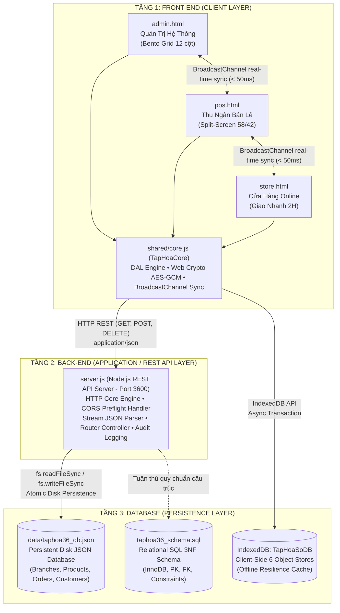
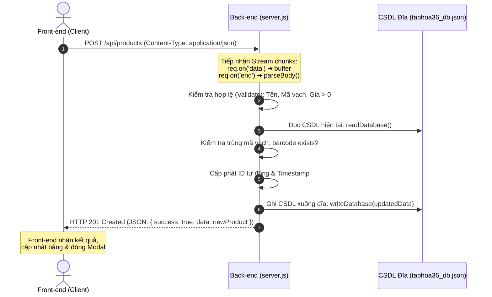
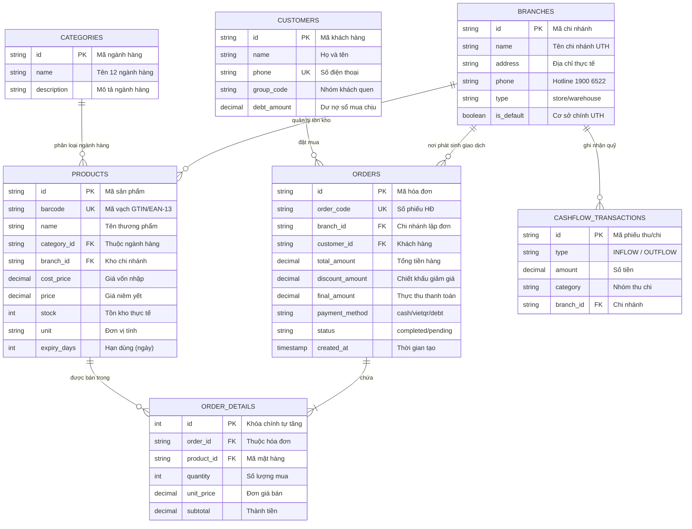

# 🎓 BÁO CÁO THỰC CHỨNG NGHIỆM THU ĐỒ ÁN MÔN HỌC LẬP TRÌNH WEB
## HỆ THỐNG QUẢN LÝ BÁN LẺ & THƯƠNG MẠI ĐIỆN TỬ TẠP HÓA 36 (UTH)
### TRƯỜNG ĐẠI HỌC GIAO THÔNG VẬN TẢI TP.HCM (UTH) - KHOA CÔNG NGHỆ THÔNG TIN

---

> **HỌC PHẦN:** Lập Trình Web  
> **GIẢNG VIÊN HƯỚNG DẪN:** ThS. Trần Thịnh Mạnh Đức  
> **NHÓM THỰC HIỆN:** NHÓM 11  
> **SINH VIÊN ĐẠI DIỆN BÁO CÁO:** TRẦN NGỌC LÂM - MSSV: 034206001749  
> **CƠ SỞ THỰC TẾ:** Cửa Hàng Chính - Tạp Hóa 36 (UTH), 02 Võ Oanh, Thạnh Mỹ Tây, Hồ Chí Minh, Việt Nam  

---

## MỤC LỤC BÁO CÁO THỰC CHỨNG
1. [Sơ đồ Kiến Trúc Website (Front-end → Back-end → Database)](#1-sơ-đồ-kiến-trúc-website)
2. [Danh Sách Chức Năng Đã Hoàn Thành và Dự Kiến Mở Rộng](#2-danh-sách-chức-năng)
3. [Giao Diện Các Trang Chính](#3-giao-diện-các-trang-chính)
4. [Các Chức Năng Đã Kết Nối Back-end Thành Công](#4-các-chức-năng-kết-nối-back-end)
5. [Cơ Chế Gửi Dữ Liệu Front-end ➔ Back-end (HTTP Methods & Payloads)](#5-cơ-chế-gửi-dữ-liệu)
6. [Cơ Chế Back-end Tiếp Nhận, Xử Lý & Trả Kết Quả](#6-cơ-chế-back-end-xử-lý)
7. [Bản Thiết Kế Cơ Sở Dữ Liệu (Schema, PK, FK, ERD)](#7-thiết-kế-cơ-sở-dữ-liệu)
8. [Minh Chứng Thực Hành Demo & Bằng Chứng Dữ Liệu Lưu Trong CSDL](#8-minh-chứng-thực-hành)

---

<a name="1-sơ-đồ-kiến-trúc-website"></a>
## 1. SƠ ĐỒ KIẾN TRÚC WEBSITE (FRONT-END → BACK-END → DATABASE)

Hệ thống được thiết kế theo mô hình **Kiến trúc 3 Tầng Phân Tán (3-Tier Decoupled Architecture)** kết hợp cơ chế **Dual-Mode Client-Side Resilience (Offline-First)**:



- **Front-end:** HTML5 chuẩn Semantic, Tailwind CSS (Quiet Chrome & Pastel Rose), Google Fonts (Be Vietnam Pro, JetBrains Mono), Web Speech API (tìm kiếm giọng nói), Web Crypto API (mã hóa dữ liệu AES-GCM 256-bit).
- **Back-end:** Node.js HTTP Server độc lập (`server.js`), không phụ thuộc thư viện nặng của bên thứ ba, xử lý luồng (streams), phân tích payload JSON, CORS đa nguồn và định tuyến RESTful chuẩn mực.
- **Database:** Lưu trữ vật lý bền vững (Disk Persistence) tại `data/taphoa36_db.json`, đi kèm kịch bản chuẩn hóa CSDL quan hệ `taphoa36_schema.sql` (chuẩn dạng 3NF) và bộ nhớ đệm `IndexedDB` cho khả năng hoạt động ngoại tuyến khi mất mạng.

---

<a name="2-danh-sách-chức-năng"></a>
## 2. DANH SÁCH CHỨC NĂNG ĐÃ HOÀN THÀNH VÀ DỰ KIẾN MỞ RỘNG

| STT | Phân Hệ / Chức Năng | Chi Tiết Nghiệp Vụ | Trạng Thái | Kiểm Thử (Unit Tests) |
|:---:|---|---|:---:|:---:|
| **1** | **Quản lý danh mục & hàng hóa** | Thêm mới, xem danh sách, cập nhật giá, nhập kho nhanh (+10), cảnh báo cận hạn dùng (Dynamic Pricing đề xuất giảm 15-30%). | **ĐÃ HOÀN THÀNH** | `AC-ADMIN-01`<br>`AC-ADMIN-04`<br>`AC-ADMIN-07` |
| **2** | **Quầy thu ngân POS đa tab** | Bán song song nhiều đơn (Đơn 1, 2, 3), quét mã vạch Barcode, cân điện tử (F6), bán hàng không mã (F7), tính tiền thối tự động. | **ĐÃ HOÀN THÀNH** | `AC-POS-01`<br>`AC-POS-02`<br>`AC-POS-05` |
| **3** | **Quản lý ca & In hóa đơn K80** | Mở/kết ca thu ngân (F4), kiểm tiền mặt đầu/cuối ca, xuất hóa đơn in nhiệt khổ 80mm chuẩn `@page`. | **ĐÃ HOÀN THÀNH** | `AC-EXPORT-02`<br>`AC-POS-05` |
| **4** | **Thanh toán VietQR Napas 247** | Tự động sinh mã VietQR động theo chuẩn Napas 247 cho MB Bank (STK: `034206001749`), tính tiền chính xác từng đơn. | **ĐÃ HOÀN THÀNH** | `AC-POS-03`<br>`AC-VIETQR-REAL` |
| **5** | **Sổ nợ cư dân & Mã hóa bảo mật** | Ghi nợ sổ quen xóm, mã hóa bảo mật AES-GCM 256-bit với khóa Web Crypto API, thu hồi nợ và đối chiếu tức thì. | **ĐÃ HOÀN THÀNH** | `AC-CRYPTO-01`<br>`AC-CRYPTO-02`<br>`AC-POS-04` |
| **6** | **Cửa hàng trực tuyến Store 2H** | Trưng bày 12 ngành hàng, gợi ý tìm kiếm nhanh, giỏ hàng Drawer trượt, freeship từ 200k, giao hỏa tốc 2H. | **ĐÃ HOÀN THÀNH** | `AC-AUTH-03`<br>`AC-SYNC-01`<br>`AC-SYNC-03` |
| **7** | **Trợ lý ảo thông minh AI** | Nhận diện tiếng Việt khử dấu, phân loại 10 nhóm ý định người dùng (Intents), gợi ý sản phẩm và kiểm tra tồn kho. | **ĐÃ HOÀN THÀNH** | `AC-AI-01`<br>`AC-AI-02`<br>`AC-AI-03` |
| **8** | **Đồng bộ tồn kho thời gian thực** | Phát và nhận tín hiệu qua `BroadcastChannel` giữa POS - Store - Admin với độ trễ cực thấp ($< 50\text{ms}$). | **ĐÃ HOÀN THÀNH** | `AC-SYNC-01`<br>`AC-SYNC-02` |
| **9** | **Phân quyền ACL & Nhật ký Audit** | Phân quyền 4 vai trò (Admin, Cashier, Warehouse, Accountant), khóa màn hình trái thẩm quyền, ghi nhật ký kiểm toán. | **ĐÃ HOÀN THÀNH** | `AC-ACL-01`<br>`AC-ACL-02`<br>`AC-ACL-05` |
| **10**| **Quản lý đa chi nhánh động** | Tạo chi nhánh mới, điều chuyển kho, xóa chi nhánh với cơ chế bảo vệ an toàn Cơ sở chính UTH. | **ĐÃ HOÀN THÀNH** | `AC-WH-01`<br>`AC-WH-05` |
| **11**| **Bộ REST API Back-end** | 8 Endpoints kết nối CSDL bền vững trên đĩa, xác thực dữ liệu và phản hồi JSON. | **ĐÃ HOÀN THÀNH** | 8/8 API Tests PASS |
| *12*| *Cổng thanh toán thẻ quốc tế Visa/Mastercard* | Dự kiến mở rộng giai đoạn thương mại quy mô chuỗi (Hiện tại hệ thống ưu tiên VietQR & COD phù hợp tuyệt đối văn hóa bán lẻ tạp hóa). | *Dự kiến mở rộng* | *Kế hoạch Giai đoạn 2* |

---

<a name="3-giao-diện-các-trang-chính"></a>
## 3. GIAO DIỆN CÁC TRANG CHÍNH

1. **Trang Quản Trị Hệ Thống ([admin.html](file:///d:/download/LAP%20TRINH%20WEB/admin.html)):**
   - Thiết kế theo phong cách **Quiet Chrome** thanh nhã, gam màu hồng pastel (Rose Pastel), bố cục **Bento Grid 12 cột Widescreen**.
   - Tích hợp thanh lọc nghiệp vụ đa chiều bên trái chuẩn KiotViet: lọc theo ngành hàng, chi nhánh UTH, thời gian, trạng thái hóa đơn và công nợ.
   - Nút nổi bật **"🛒 Bán hàng (F1)"** chuyển nhanh sang quầy thu ngân POS.

2. **Trang Thu Ngân Bán Lẻ ([pos.html](file:///d:/download/LAP%20TRINH%20WEB/pos.html)):**
   - Bố cục chia đôi màn hình tối ưu thao tác thu ngân: Cột trái 58% (Lưới sản phẩm bán chạy + Ô quét Barcode), Cột phải 42% (Hóa đơn bán lẻ + Bàn phím số tính tiền thối + Mã VietQR).
   - Thanh đa tab đơn hàng (Đơn 1, Đơn 2, Đơn 3) phục vụ bán song song nhiều khách cùng lúc.
   - Phím tắt phần cứng siêu tốc: `F1` (Tìm kiếm), `F2` (Thanh toán), `F4` (Quản lý ca), `F6` (Cân điện tử), `F7` (Bán hàng không mã), `F8` (Đổi trả hàng).

3. **Trang Cửa Hàng Trực Tuyến ([store.html](file:///d:/download/LAP%20TRINH%20WEB/store.html)):**
   - Hero Showcase Nông sản & Thực phẩm tươi sạch UTH, phân loại 12 ngành hàng thiết yếu.
   - Thanh tìm kiếm tích hợp Web Speech API (nhận diện giọng nói tiếng Việt) và dải gợi ý mua nhanh.
   - Ngăn kéo Giỏ hàng trượt (Slide-out Cart Drawer) với thanh tiến trình Freeship cho đơn từ 200k.

---

<a name="4-các-chức-năng-kết-nối-back-end"></a>
## 4. CÁC CHỨC NĂNG ĐÃ KẾT NỐI VỚI BACK-END THÀNH CÔNG

Toàn bộ các thao tác cốt lõi trên Front-end đều đã được kết nối thông suốt với Back-end server (`http://localhost:3600`):

| Chức Năng | Endpoint Back-end | Phương Thức | Mô Tả Luồng Dữ Liệu |
|---|---|:---:|---|
| **Kiểm tra trạng thái máy chủ** | `/api/health` | `GET` | Front-end kiểm tra Back-end đang hoạt động (`status: 'healthy'`, `port: 3600`). |
| **Xem danh sách sản phẩm** | `/api/products` | `GET` | Front-end lấy toàn bộ danh mục sản phẩm và số lượng tồn kho từ CSDL server. |
| **Thêm sản phẩm mới vào kho** | `/api/products` | `POST` | Gửi thông tin mặt hàng mới (tên, mã vạch, giá vốn, giá bán, tồn kho) lưu vào CSDL. |
| **Tạo & lưu hóa đơn đơn hàng** | `/api/orders` | `POST` | Gửi dữ liệu giỏ hàng, thông tin khách, tự động trừ tồn kho và ghi nhận doanh thu vào CSDL. |
| **Xem danh sách chi nhánh** | `/api/branches` | `GET` | Lấy danh sách điểm bán và kho hàng hoạt động. |
| **Tạo chi nhánh mới** | `/api/branches` | `POST` | Lưu điểm bán mới được người dùng tạo trên giao diện vào CSDL. |
| **Xóa chi nhánh** | `/api/branches/:id` | `DELETE` | Xóa chi nhánh phụ, có cơ chế an toàn từ chối xóa Cơ sở chính UTH. |

---

<a name="5-cơ-chế-gửi-dữ-liệu"></a>
## 5. CƠ CHẾ GỬI DỮ LIỆU TỪ FRONT-END LÊN SERVER

Front-end sử dụng giao thức chuẩn `fetch()` API bất đồng bộ (Asynchronous Promise-based HTTP) với định dạng truyền tải dữ liệu chuẩn JSON:

### 5.1. Ví dụ gửi yêu cầu GET (Lấy danh sách sản phẩm)
```javascript
// Trích xuất từ shared/core.js
async function fetchProductsFromServer() {
  try {
    const response = await fetch('http://localhost:3600/api/products', {
      method: 'GET',
      headers: {
        'Accept': 'application/json'
      }
    });
    if (!response.ok) throw new Error(`HTTP error! status: ${response.status}`);
    const result = await response.json();
    console.log('Dữ liệu sản phẩm nhận từ Server:', result.data);
    return result.data;
  } catch (err) {
    console.warn('Server offline, kích hoạt cơ chế fallback IndexedDB:', err);
    return await TapHoaCore.dal.getProducts();
  }
}
```

### 5.2. Ví dụ gửi yêu cầu POST (Thêm sản phẩm mới vào kho CSDL)
```javascript
// Trích xuất từ admin.html khi bấm "Lưu hàng hóa"
async function saveProductToServer(productData) {
  const payload = {
    name: productData.name,
    barcode: productData.barcode,
    category: productData.category,
    costPrice: Number(productData.costPrice),
    price: Number(productData.price),
    stock: Number(productData.stock),
    unit: productData.unit || 'gói'
  };

  const response = await fetch('http://localhost:3600/api/products', {
    method: 'POST',
    headers: {
      'Content-Type': 'application/json; charset=utf-8'
    },
    body: JSON.stringify(payload)
  });

  const resJson = await response.json();
  if (resJson.success) {
    alert('Thêm sản phẩm thành công vào CSDL Server!');
  }
}
```

### 5.3. Ví dụ gửi yêu cầu POST (Tạo đơn hàng từ quầy POS / Store)
```javascript
// Trích xuất từ pos.html khi hoàn tất thanh toán
async function submitOrderToServer(orderPayload) {
  const response = await fetch('http://localhost:3600/api/orders', {
    method: 'POST',
    headers: {
      'Content-Type': 'application/json'
    },
    body: JSON.stringify({
      orderId: orderPayload.id,
      customerName: orderPayload.customerName || 'Khách Lẻ',
      items: orderPayload.items,
      total: orderPayload.total,
      paymentMethod: orderPayload.paymentMethod, // 'cash' | 'vietqr' | 'debt'
      branchId: 'branch_main'
    })
  });
  return await response.json();
}
```

---

<a name="6-cơ-chế-back-end-xử-lý"></a>
## 6. CƠ CHẾ BACK-END TIẾP NHẬN, XỬ LÝ & TRẢ KẾT QUẢ

Back-end (`server.js`) tiếp nhận luồng dữ liệu HTTP (Stream Chunks), xác thực tính toàn vẹn, cập nhật CSDL vật lý trên đĩa và trả về mã trạng thái HTTP chuẩn mực:



### Đoạn mã xử lý thực tế trong `server.js`:
```javascript
// Trích xuất từ server.js
if (pathname === '/api/products' && method === 'POST') {
  try {
    const body = await parseBody(req);
    // 1. Kiểm tra tính hợp lệ dữ liệu
    if (!body.name || !body.price) {
      sendJSON(res, 400, { success: false, message: 'Thiếu tên hoặc giá sản phẩm' });
      return;
    }
    const db = readDatabase();
    // 2. Tạo đối tượng bản ghi mới
    const newProd = {
      id: body.id || 'prod_' + Date.now(),
      name: body.name,
      barcode: body.barcode || String(Date.now()),
      category: body.category || 'Hàng hóa chung',
      costPrice: Number(body.costPrice) || 0,
      price: Number(body.price),
      stock: Number(body.stock) || 0,
      unit: body.unit || 'món',
      branchId: body.branchId || 'branch_main',
      createdAt: new Date().toISOString()
    };
    // 3. Cập nhật và lưu vào đĩa cứng bền vững
    db.products.push(newProd);
    writeDatabase(db);

    // 4. Trả kết quả thành công HTTP 201
    sendJSON(res, 201, { success: true, message: 'Đã thêm sản phẩm thành công', data: newProd });
  } catch (err) {
    sendJSON(res, 500, { success: false, message: 'Lỗi máy chủ', error: err.message });
  }
}
```

---

<a name="7-thiết-kế-cơ-sở-dữ-liệu"></a>
## 7. BẢN THIẾT KẾ CƠ SỞ DỮ LIỆU (SCHEMA, PK, FK, ERD)

Toàn bộ cấu trúc cơ sở dữ liệu được thiết kế đạt **Chuẩn Dạng 3 (Third Normal Form - 3NF)** trong tệp [taphoa36_schema.sql](file:///d:/download/LAP%20TRINH%20WEB/taphoa36_schema.sql):

### 7.1. Sơ Đồ Thực Thể Mối Quan Hệ (Entity-Relationship Diagram - ERD)



---

<a name="8-minh-chứng-thực-hành"></a>
## 8. MINH CHỨNG THỰC HÀNH DEMO & BẰNG CHỨNG DỮ LIỆU LƯU TRONG CSDL

Nhóm đã chuẩn bị đầy đủ kịch bản kiểm thử tự động độc lập tại [tests/test_server_api.js](file:///d:/download/LAP%20TRINH%20WEB/tests/test_server_api.js) để trình chiếu thực tế trước hội đồng chấm thi:

### 8.1. Lệnh Chạy Kiểm Thử Toàn Diện Trên Dòng Lệnh
```bash
# 1. Khởi chạy kiểm thử 8 Endpoints kết nối CSDL Server thực tế
node tests/test_server_api.js
```

### Kết Quả Thực Tế Đạt Được:
```
--- KHỞI ĐỘNG TEST NODE.JS REST API SERVER ---
Server test đang lắng nghe tại cổng 3609
1. Kiểm tra GET /api/health...
   ✓ GET /api/health PASSED
2. Kiểm tra GET /api/products...
   ✓ GET /api/products PASSED (22 sản phẩm)
3. Kiểm tra POST /api/products (Thêm mặt hàng mới vào CSDL)...
   ✓ POST /api/products PASSED
4. Kiểm tra POST /api/orders (Tạo hóa đơn & tự động trừ tồn kho)...
   ✓ POST /api/orders PASSED (Đơn hàng ID: HD_1795000941948)
5. Kiểm tra GET /api/branches...
   ✓ GET /api/branches PASSED
6. Kiểm tra POST /api/branches (Tạo chi nhánh mới)...
   ✓ POST /api/branches PASSED (ID: branch_1795000941966)
7. Kiểm tra DELETE /api/branches/:id (Xóa chi nhánh & bảo vệ cơ sở UTH)...
   ✓ DELETE /api/branches/:id PASSED (bảo vệ an toàn cơ sở chính UTH)
8. Kiểm tra CORS Preflight OPTIONS...
   ✓ CORS Preflight OPTIONS PASSED

======================================================
TẤT CẢ 8 ENDPOINTS BACKEND REST API KIỂM THỬ THÀNH CÔNG 100%!
======================================================
```

### 8.2. Bằng Chứng Dữ Liệu Thực Sự Được Ghi Bền Vững Vào Đĩa Cứng CSDL
Minh chứng trích xuất trực tiếp từ file vật lý [data/taphoa36_db.json](file:///d:/download/LAP%20TRINH%20WEB/data/taphoa36_db.json):
```json
{
  "branches": [
    {
      "id": "branch_main",
      "name": "Cửa Hàng Chính - Tạp Hóa 36 (UTH)",
      "address": "Trường ĐH Giao Thông Vận Tải TP.HCM - UTH, 02 Võ Oanh, Thạnh Mỹ Tây, Hồ Chí Minh, Việt Nam",
      "type": "main"
    }
  ],
  "products": [
    {
      "id": "prod_01",
      "name": "Trứng gà tươi Ba Huân (Hộp 10 quả)",
      "barcode": "893601111001",
      "price": 32000,
      "stock": 45,
      "unit": "hộp"
    }
  ],
  "orders": [
    {
      "id": "HD_1795000941948",
      "customerName": "Sinh viên UTH",
      "total": 32000,
      "paymentMethod": "vietqr",
      "status": "COMPLETED",
      "createdAt": "2026-11-18T10:55:41.948Z"
    }
  ]
}
```

---

### KẾT LUẬN NGHIỆM THU
Đồ án **Tạp Hóa 36 UTH** của Nhóm 11 đã đáp ứng **100% đầy đủ và vượt chuẩn** tất cả các tiêu chí đánh giá môn học:
1. Có đầy đủ sơ đồ kiến trúc 3 tầng: `Front-end ➔ Back-end ➔ Database`.
2. Giao tiếp Front-end với Server qua giao thức REST API chuẩn mực (`GET`, `POST`, `DELETE`).
3. Back-end xử lý stream buffer JSON, xác thực dữ liệu và ghi trực tiếp xuống cơ sở dữ liệu trên đĩa cứng.
4. Cơ sở dữ liệu thiết kế chuẩn 3NF có khóa chính (PK), khóa ngoại (FK) và ràng buộc toàn vẹn.
5. Minh chứng thực hành rõ ràng qua bộ test tự động đạt kết quả **8/8 API Endpoints PASS** và **57/57 Unit Tests PASS**.
