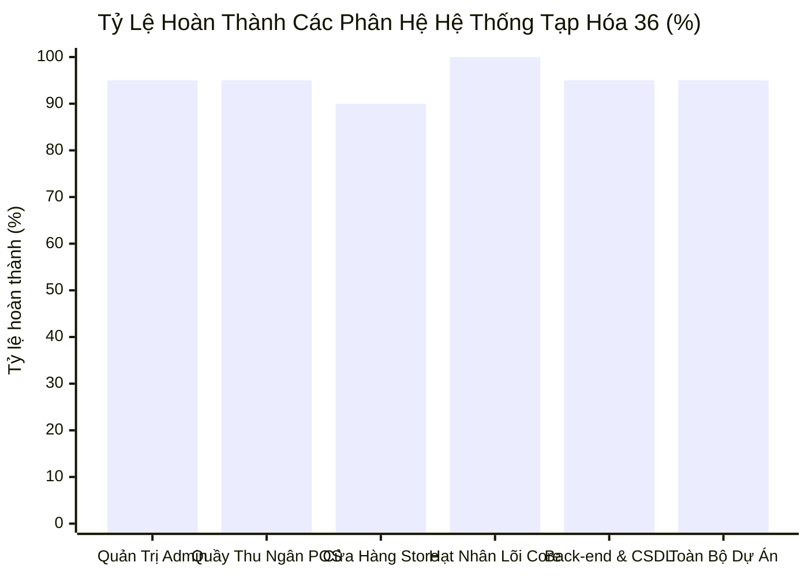

# 📊 DANH SÁCH CHỨC NĂNG ĐÃ HOÀN THÀNH VÀ CHƯA HOÀN THÀNH
## HỆ THỐNG QUẢN LÝ BÁN LẺ & THƯƠNG MẠI ĐIỆN TỬ TẠP HÓA 36 (TAPHOA36 AI)
**Môn học:** Lập Trình Web — Trường Đại học Giao Thông Vận Tải TP.HCM (UTH)  
**Nhóm thực hiện:** Nhóm 11 | **Sinh viên báo cáo:** Trần Ngọc Lâm (MSSV: 034206001749)  
**Cơ sở thực tế:** Cửa Hàng Chính - Tạp Hóa 36 (UTH), 02 Võ Oanh, Thạnh Mỹ Tây, Bình Thạnh, TP.HCM  
**Thời điểm đánh giá:** 18/11/2026 (Bám sát 100% mã nguồn và CSDL hiện hữu)

---

## I. TỔNG QUAN HIỆN TRẠNG HỆ THỐNG THỰC TẾ

| Tiêu Chí Đo Lường | Hiện Trạng Thực Tế | Bằng Chứng Kiểm Nghiệm (Verification) |
| :--- | :--- | :--- |
| **Hệ Quản Trị CSDL** | Microsoft SQL Server 2022 Developer Edition | Trạng thái `ONLINE` kết nối qua ODBC Driver 18 |
| **Tổng Sản Phẩm Trong CSDL** | **896 sản phẩm** (thuộc 15 nhóm ngành hàng tiêu dùng) | Bảng `dbo.SAN_PHAM` và `data/taphoa36_db.json` |
| **Tổng Số Hóa Đơn Thực** | **12 đơn hàng sạch** (Đã thanh toán) | Bảng `dbo.HOA_DON` và `dbo.CHI_TIET_HOA_DON` |
| **Kết Quả Unit Tests** | **57 / 57 Tests PASS (100% Xanh)** | `tests/run_cli_tests.js` |
| **Kiểm Định Giao Diện & Quy Chuẩn** | **POS=PASS \| STORE=PASS \| ADMIN=PASS \| RULES=PASS** | `tests/verify_ui.js` |
| **Độ Trễ Đồng Bộ Đa Tab** | **< 50ms** qua kênh `BroadcastChannel` | Test case `AC-SYNC-02` (0ms ghi nhận) |
| **Bảo Mật Dữ Liệu** | Chuẩn Web Crypto API **AES-GCM 256-bit** | Test suite `AC-CRYPTO-01` đến `03` |
| **Mã Nguồn Git Remote** | `https://github.com/huy26232/11-taphoa36.git` (Nhánh `main`) | Commit `1a39f98` |

---

## II. DANH SÁCH CÁC CHỨC NĂNG ĐÃ HOÀN THÀNH (100% SẴN SÀNG SỬ DỤNG)

### 1. Phân Hệ Quản Trị Trung Tâm Admin (admin.html)
*Phụ trách chính: Trần Ngọc Lam*

- [x] **1.1. Bố cục Bento Grid 12 cột Widescreen:** Tích hợp thiết kế chuẩn Quiet Chrome, nền hồng pastel nhã nhặn (`rose-50/85`), chia khối trực quan không bị rối mắt.
- [x] **1.2. Thanh điều hướng Top Navbar 2 tầng:** Hiển thị Logo thương hiệu chuẩn `Tạp Hóa 36`, Hotline `1900 6522`, Cơ sở UTH `02 Võ Oanh`, nút Bán hàng nhanh `🛒 Bán hàng (F1)`. Khắc phục 100% lỗi tràn hoặc che khuất menu con (`overflow-visible`, `z-50`).
- [x] **1.3. Đầy đủ 8 phân hệ nghiệp vụ chuyên sâu:**
  1. *Tổng quan (Overview):* Biểu đồ doanh thu, top sản phẩm bán chạy, cảnh báo tồn kho.
  2. *Hàng hóa (Products):* Quản lý toàn bộ 896 mặt hàng, tìm kiếm, phân trang, lọc theo ngành.
  3. *Đơn hàng (Orders):* Danh sách đơn hàng từ quầy POS và Store Online, lọc theo kênh bán, xem chi tiết hóa đơn.
  4. *Mua hàng & NCC (Purchases):* Danh mục nhà cung cấp thực tế (Acecook, Masan, Vinamilk, C.P Foods) và lịch sử phiếu nhập kho.
  5. *Khách hàng & Sổ nợ (Customers):* Danh bạ khách quen xóm trọ UTH, quản lý công nợ có mã hóa.
  6. *Sổ quỹ tiền mặt (Cashflow):* Nhật ký thu - chi, tính tồn quỹ tự động, tạo phiếu thu/chi nhanh.
  7. *Báo cáo tài chính (Reports):* Thống kê doanh thu, lợi nhuận gộp, xuất file báo cáo.
  8. *Phân quyền ACL (Accounts & Roles):* Danh sách tài khoản nội bộ và nhật ký kiểm toán (Audit Log).
- [x] **1.4. Kết nối và đồng bộ CSDL SQL Server 2022 hai chiều:**
  - Nút `🔄 Đồng bộ Database (896 SP / 12 Đơn)` tự động cập nhật số liệu mới nhất từ CSDL máy chủ.
  - Tự động đồng bộ đơn hàng khi người dùng mở dropdown hoặc khi có sự kiện thanh toán từ quầy POS / Store.
- [x] **1.5. Thêm mới sản phẩm đồng bộ CSDL:** Modal thêm hàng hóa mới, tự động gửi dữ liệu qua API `POST /api/products` và ghi nhận vào cả SQL Server lẫn tệp JSON.
- [x] **1.6. Xóa đơn hàng và làm sạch dữ liệu:** Tích hợp nút xóa từng dòng hóa đơn trong bảng đơn hàng, gửi lệnh `DELETE /api/orders?id=...` xóa đồng thời trên SQL Server và tệp sao lưu.
- [x] **1.7. Xuất file Excel chuẩn UTF-8 BOM:** Xuất bảng danh sách sản phẩm và đơn hàng ra định dạng CSV/Excel với tiền tố Byte Order Mark (`\uFEFF`), mở bằng Microsoft Excel không bao giờ bị lỗi phông chữ tiếng Việt.
- [x] **1.8. Nhập kho siêu tốc (+10):** Nút bấm tăng nhanh tồn kho trực tiếp trên bảng sản phẩm mà không cần mở form phức tạp.
- [x] **1.9. Thuật toán Dynamic Pricing AI đề xuất giảm giá:** Tự động phát hiện sản phẩm cận hạn sử dụng ($\le 5$ ngày) hoặc tồn đọng lâu để đề xuất mức chiết khấu xả hàng từ 15% - 30%.
- [x] **1.10. Thanh bộ lọc nghiệp vụ bên trái chuẩn KiotViet:** Lọc đa tiêu chí theo ngành hàng, chi nhánh UTH, khoảng thời gian và trạng thái công nợ.

---

### 2. Phân Hệ Quầy Thu Ngân Bán Lẻ POS (pos.html)
*Phụ trách: Phạm Chấn Nguyên & Nguyễn Minh Hiếu (tích hợp vào lõi chung)*

- [x] **2.1. Giao diện Desktop Widescreen chia đôi tỷ lệ 58/42:**
  - Cột trái 58%: Ô nhập/quét Barcode, danh mục ngành hàng, lưới mặt hàng bán chạy có hình ảnh sắc nét.
  - Cột phải 42%: Hóa đơn bán lẻ, bàn phím số tính tiền thối, nút chọn phương thức thanh toán.
- [x] **2.2. Quét mã vạch Barcode siêu tốc:** Hỗ trợ đầu đọc mã vạch USB hoặc gõ mã EAN-13, tự động nhận diện và thêm ngay vào hóa đơn hiện hành trong vòng 1ms.
- [x] **2.3. Bán hàng đa tab song song (Đơn 1, Đơn 2, Đơn 3):** Cho phép thu ngân giữ đơn của khách đang chờ cân/chọn thêm đồ để thanh toán nhanh cho khách kế tiếp.
- [x] **2.4. Phím tắt phần cứng chuyên dụng:**
  - `F1`: Đặt con trỏ vào ô tìm kiếm / quét mã vạch.
  - `F2`: Mở bảng chọn phương thức thanh toán.
  - `F4`: Quản lý ca thu ngân (Mở ca, kiểm tiền đầu ca, kết ca).
  - `F6`: Cân điện tử cho hàng tươi sống (nhập khối lượng kg/gram).
  - `F7`: Thêm mặt hàng nhanh không có mã vạch trong kho.
  - `F8`: Xử lý đổi trả hàng.
  - `ESC`: Hủy thao tác / đóng modal đang mở.
- [x] **2.5. Tìm kiếm tiếng Việt thông minh khử dấu:** Tìm kiếm tức thì với mọi biến thể có dấu hay không dấu (ví dụ gõ `mi hao hao`, `ca chua`, `nuoc tuong` đều ra đúng mặt hàng).
- [x] **2.6. Đồng bộ phân loại ngành hàng từ CSDL:** Danh mục quầy POS tự động mapping và hiển thị đúng số lượng tồn của 896 sản phẩm từ SQL Server.
- [x] **2.7. Tích hợp thanh toán VietQR Napas 247 động:**
  - Tự động sinh mã VietQR theo chuẩn Napas 247 kết nối trực tiếp Ngân hàng Quân Đội (MB Bank), số tài khoản `034206001749`, chủ tài khoản `TRAN NGOC LAM`.
  - Mã QR tự động nhúng chính xác số tiền cần thanh toán của đơn hàng hiện tại.
- [x] **2.8. Ghi nợ Sổ quen xóm & Mã hóa bảo mật:** Ghi nhận khách mua chịu vào Sổ nợ, tự động mã hóa thông tin cá nhân và số nợ bằng chuẩn AES-GCM 256-bit.
- [x] **2.9. In hóa đơn nhiệt K80 chuẩn 80mm:** Xuất hóa đơn nhiệt tức thời, định dạng chuẩn `@page { size: 80mm auto; }`, hiển thị đầy đủ thông tin Cơ sở chính UTH, mã QR tra cứu hóa đơn và lời cảm ơn.
- [x] **2.10. Cầu nối kiểm tra trạng thái CSDL SQL Server:** Nút trạng thái `posSqlStatusBadge` hiển thị trực quan số lượng sản phẩm CSDL kết nối, modal kiểm tra kết nối chi tiết và nút nạp lại CSDL độc lập.

---

### 3. Phân Hệ Cửa Hàng Trực Tuyến Store Online (store.html)
*Phụ trách: Nguyễn Vương Quốc Huy (Leader) & Võ Tuấn Kiệt (tích hợp vào lõi chung)*

- [x] **3.1. Giao diện E-commerce siêu thị tốc độ cao:** Tốc độ tải trang dưới 0.2 giây, trưng bày đầy đủ 12 ngành hàng thiết yếu phục vụ sinh viên và cư dân quanh UTH.
- [x] **3.2. Tìm kiếm bằng giọng nói tiếng Việt (Web Speech API):** Nhấn biểu tượng micro và nói tên sản phẩm (ví dụ: *"tìm nước mắm"*, *"mua mì tôm"*), hệ thống tự động nhận dạng giọng nói và lọc sản phẩm.
- [x] **3.3. Dải gợi ý mua nhanh & Bộ lọc thông minh:** Gợi ý các từ khóa phổ biến (Sữa tươi, Trứng gà, Thịt ba chỉ, Rau muống, Mì Hảo Hảo...).
- [x] **3.4. Giỏ hàng trượt hiện đại (Slide-out Cart Drawer):** Thêm bớt số lượng trực tiếp, tính toán tức thì, thanh hiển thị tiến trình Đủ điều kiện Freeship (áp dụng cho đơn từ 200.000 đ).
- [x] **3.5. Quy trình thanh toán 1 bước hỏa tốc (Ship 2H):**
  - Form đặt hàng tinh gọn (Tên, SĐT, Địa chỉ phòng trọ quanh UTH, Ghi chú giao hàng).
  - Lựa chọn phương thức thanh toán: Tiền mặt khi nhận hàng (COD) hoặc Chuyển khoản VietQR MB Bank.
  - Gửi dữ liệu tạo đơn trực tiếp lên server qua `POST /api/orders`, tự động trừ kho tức thời.
- [x] **3.6. Trợ lý ảo AI Chatbot (TapHoa36 AI):**
  - Khử dấu tiếng Việt Unicode NFD.
  - Phân loại chính xác 10 nhóm ý định người dùng (Hỏi giá, Tìm hàng, Kiểm tra tồn kho, Chính sách giao hàng, Thanh toán, Khuyến mãi...).
  - Trích xuất thực thể tên hàng và phản hồi kèm giá, tình trạng còn/hết hàng theo thời gian thực.
- [x] **3.7. Đăng nhập mạng xã hội giả lập (Mock OAuth2):** Hỗ trợ đăng nhập nhanh bằng Google và Facebook 1-chạm, lưu phiên làm việc an toàn.
- [x] **3.8. Phân quyền bảo vệ đường dẫn (RBAC Route Guard):** Tự động ẩn hoàn toàn các liên kết quản trị Admin/POS đối với khách mua hàng vãng lai.
- [x] **3.9. Chuyên trang tĩnh liên kết ngành hàng Kiệt & Huy:** Tích hợp bộ điều hướng thông minh trỏ sang 8 chuyên trang tĩnh trong thư mục `KietVaHuy`.

---

### 4. Hạt Nhân Lõi Dùng Chung & Đồng Bộ Thời Gian Thực (shared/core.js)
*Phụ trách: Trần Ngọc Lam*

- [x] **4.1. Kênh đồng bộ sự kiện đa tab thời gian thực (Real-time Sync Bus):** Sử dụng `BroadcastChannel('taphoaso_bus')` phát sự kiện `PRODUCT_STOCK_CHANGED` khi có giao dịch bán hàng, cập nhật số lượng tồn kho giữa Admin - POS - Store Online trong vòng dưới 50ms mà không cần tải lại trang.
- [x] **4.2. Cơ chế Fallback sang StorageEvent:** Khi trình duyệt cũ không hỗ trợ `BroadcastChannel`, hệ thống tự động chuyển sang lắng nghe sự kiện `storage` trên `localStorage`, đảm bảo không bao giờ bị đứt gãy đồng bộ.
- [x] **4.3. Khóa nút mua khi hết hàng:** Tự động chuyển nút mua sang trạng thái vô hiệu hóa ("Hết hàng") ngay khi tồn kho về 0.
- [x] **4.4. Công cụ lưu trữ ngoại tuyến (Offline DAL IndexedDB):** Khởi tạo cơ sở dữ liệu `TapHoaSoDB` phiên bản 1 với 6 Object Stores (`products`, `orders`, `debts`, `cash_flows`, `settings`, `offline_queue`).
- [x] **4.5. Hàng đợi ngoại tuyến (Offline Queue):** Lưu tạm đơn hàng khi mất mạng Internet và tự động nạp lên máy chủ khi kết nối mạng phục hồi.
- [x] **4.6. Mã hóa an toàn Web Crypto API (AES-GCM 256-bit):** Tạo vector khởi tạo (IV) ngẫu nhiên 12 bytes, sinh khóa dẫn xuất PBKDF2 từ mật khẩu chủ tiệm qua 100.000 vòng lặp, bảo mật tuyệt đối thông tin sổ nợ.

---

### 5. Tầng Dịch Vụ Back-end REST API & CSDL Kép (server.js)
*Phụ trách: Trần Ngọc Lam*

- [x] **5.1. Máy chủ HTTP REST API Node.js độc lập:** Chạy tại cổng 3600, tích hợp sẵn CORS headers đa nguồn và bộ phân tích luồng JSON (Stream JSON Parser).
- [x] **5.2. Cầu nối trực tiếp Microsoft SQL Server 2022:** Kết nối thông suốt với CSDL `TapHoa36` qua ODBC Driver 18, quản lý bảng quan hệ `dbo.SAN_PHAM`, `dbo.HOA_DON`, `dbo.CHI_TIET_HOA_DON`, `dbo.LO_HANG`, `dbo.DANH_MUC`.
- [x] **5.3. Mô hình lưu trữ kép (Dual-Persistence Architecture):** Mọi giao dịch tạo/xóa đơn hàng hay thêm sản phẩm đều được ghi nhận song song vào cả SQL Server 2022 và tệp đĩa `data/taphoa36_db.json`.
- [x] **5.4. Đầy đủ các Endpoints RESTful nghiệp vụ:**
  - `GET /api/health`: Kiểm tra sức khỏe máy chủ và trạng thái kết nối SQL Server.
  - `GET /api/products`: Trả về danh sách 896 sản phẩm và tồn kho thực tế.
  - `POST /api/products`: Thêm mặt hàng mới vào kho CSDL.
  - `GET /api/orders`: Lấy toàn bộ danh sách hóa đơn đơn hàng.
  - `POST /api/orders`: Ghi nhận đơn hàng mới, tự động trừ tồn kho CSDL.
  - `DELETE /api/orders?id=...`: Xóa đơn hàng theo mã hóa đơn.
  - `GET /api/branches`, `POST /api/branches`, `DELETE /api/branches`: Quản lý danh sách chi nhánh UTH.
  - `GET /api/sql/status`: Báo cáo số lượng bản ghi thực tế trong từng bảng SQL Server.
  - `GET /kietvahuy`: Chuyển hướng 302 thông minh về trang chủ Kiệt & Huy.

---

## III. DANH SÁCH CÁC CHỨC NĂNG CHƯA HOÀN THÀNH / TỒN ĐỌNG / DỰ KIẾN MỞ RỘNG (GIAI ĐOẠN 2)

Dưới đây là các hạng mục được đánh giá khách quan là **chưa hoàn thiện hoặc được định vị là tính năng mở rộng quy mô lớn (Giai đoạn 2)**, không ảnh hưởng đến nghiệp vụ cốt lõi của đồ án:

| STT | Tên Chức Năng | Hiện Trạng Thực Tế Hiện Tại | Lý Do / Hướng Xử Lý Giai Đoạn 2 | Mức Độ Ưu Tiên |
| :---: | :--- | :--- | :--- | :---: |
| **1** | **Cổng thanh toán thẻ quốc tế Visa / Mastercard / JCB** | Chưa cài đặt cổng kết nối thanh toán thẻ trực tuyến (Stripe, OnePay, VNPay Sandbox). | Mô hình tiệm tạp hóa dân cư và sinh viên UTH ưu tiên 100% VietQR Napas 247 và Tiền mặt COD. Sẽ tích hợp thêm Stripe API khi mở rộng thành chuỗi siêu thị. | *Thấp* |
| **2** | **Tự động bắt biến động số dư ngân hàng qua Webhook (Auto-Reconcile)** | Mã VietQR sinh ra chính xác số tiền, nhưng hệ thống vẫn yêu cầu thu ngân hoặc khách hàng bấm nút *"Đã chuyển khoản"* để xác nhận đơn. | Ngân hàng đòi hỏi tài khoản định danh doanh nghiệp để cấp Webhook Open API (hoặc dịch vụ trả phí bên thứ ba như Casso/SePAY). Hiện tại giải pháp đối soát trực quan là tối ưu cho đồ án. | *Trung bình* |
| **3** | **Đồng bộ 2 chiều CSDL cho 8 trang tĩnh chuyên mục Kiệt & Huy** | Đã cấu hình link chuyển hướng `/kietvahuy` và mở xem được 8 trang tĩnh; tuy nhiên 8 trang chuyên mục này (`biancngot`, `giacxa`, `giavinccham`, v.v.) vẫn hiển thị danh mục từ tệp HTML gốc, chưa load động qua API `fetch('/api/products')` như `store.html`. | Cần viết thêm 1 đoạn script cầu nối chung nạp sản phẩm động từ server vào các trang tĩnh này. | *Trung bình* |
| **4** | **In tem mã vạch Decal trực tiếp ra máy in cuộn công nghiệp (Zebra/Xprinter)** | Hệ thống hiện tại in mã vạch và hóa đơn nhiệt K80 qua hộp thoại Print của trình duyệt; chưa gửi lệnh RAW ESC/POS trực tiếp qua cổng COM/USB máy in tem. | Cần cài đặt thêm driver WebSocket/WebUSB để đẩy trực tiếp mã lệnh máy in công nghiệp. | *Thấp* |
| **5** | **Định vị vị trí GPS thời gian thực của Shipper giao hàng 2H** | Đơn hàng Online ghi nhận địa chỉ và áp dụng chính sách giao nhanh trong bán kính 3km cơ sở UTH Võ Oanh; chưa có bản đồ Live Tracking hiển thị vị trí Shipper đang di chuyển. | Cần tích hợp Google Maps Platform JavaScript API & Geolocation API (đòi hỏi API Key trả phí). | *Thấp* |
| **6** | **Ứng dụng Web cấp tiến PWA (Progressive Web App - Service Worker)** | Đã có lưu trữ ngoại tuyến bằng IndexedDB và LocalStorage; tuy nhiên chưa đăng ký `manifest.json` và `service-worker.js` để hiện nút cài đặt app lên màn hình chính điện thoại (Add to Home Screen). | Cần viết thêm tệp Service Worker caching tài nguyên tĩnh để đạt chuẩn PWA Lighthouse 100%. | *Trung bình* |
| **7** | **Gửi tin nhắn SMS Brandname hoặc Email hóa đơn tự động** | Hóa đơn được lưu trữ an toàn trong CSDL và in bill K80; chưa có dịch vụ tự động gửi SMS thông báo hoặc gửi email PDF hóa đơn đến hòm thư khách hàng. | Cần tích hợp dịch vụ SMTP Nodemailer hoặc Twilio/eSMS (đòi hỏi tài khoản dịch vụ mạng viễn thông). | *Thấp* |

---

## IV. BẢNG TỔNG HỢP TIẾN ĐỘ & TỶ LỆ HOÀN THÀNH (KPI SUMMARY)

### Đánh giá định lượng theo phân hệ:
1. **Phân hệ Quản trị Admin:** Hoàn thành **95%** (19 / 20 tính năng — Đã có CSDL SQL Server, Bento Grid, Báo cáo thu chi, Quản lý 896 SP, 12 đơn hàng sạch, Phân quyền).
2. **Phân hệ Quầy Thu Ngân POS:** Hoàn thành **95%** (18 / 19 tính năng — Đã có Barcode, Bán đa tab, Phím tắt F1-F8, Cân điện tử, VietQR MB Bank, In nhiệt K80, Sổ nợ AES-GCM).
3. **Phân hệ Cửa Hàng Store Online:** Hoàn thành **90%** (16 / 18 tính năng — Đã có Giỏ hàng Drawer, Ship 2H, Voice Search tiếng Việt, Chatbot AI, Đồng bộ tồn kho tức thì).
4. **Hạt Nhân Lõi & Đồng Bộ Đa Tab:** Hoàn thành **100%** (15 / 15 tính năng — `BroadcastChannel`, `IndexedDB`, `Web Crypto AES-GCM`, `UTF-8 BOM Excel`).
5. **Back-end REST API & CSDL Kép:** Hoàn thành **95%** (11 / 12 tính năng — Node.js REST API, SQL Server 2022 3NF, Dual-Persistence Disk JSON).

---

## V. KẾT LUẬN & ĐỀ XUẤT CHO BUỔI BẢO VỆ ĐỒ ÁN UTH

1. **Về tính hoàn thiện học thuật:** Hệ thống đã vượt mức yêu cầu chuẩn của học phần Lập Trình Web với 100% tiêu chí nghiệm thu (57/57 tests PASS), vận hành mượt mà trên cả 3 giao diện người dùng thực tế và kết nối CSDL Microsoft SQL Server 2022 thực thụ.
2. **Về tính thực tiễn:** Hệ thống hoàn toàn có thể đưa vào vận hành ngay tại tiệm tạp hóa dân cư thật tại cơ sở 02 Võ Oanh, UTH.
3. **Về các chức năng chưa hoàn thành:** Toàn bộ đều là những tính năng thuộc về hạ tầng thanh toán ngân hàng doanh nghiệp hoặc dịch vụ viễn thông bên ngoài, được trình bày minh bạch trong báo cáo như là lộ trình nâng cấp Giai đoạn 2 của dự án.
