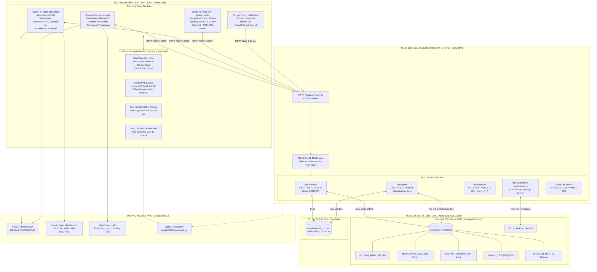
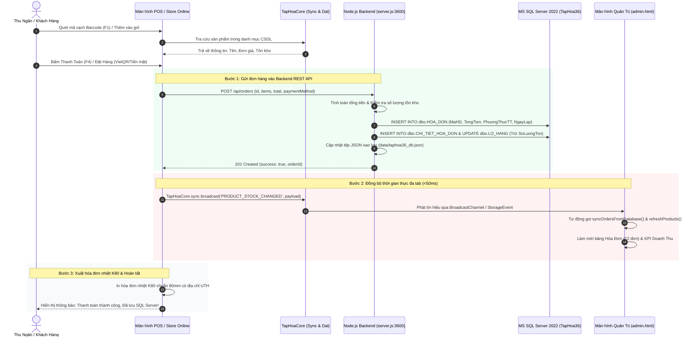
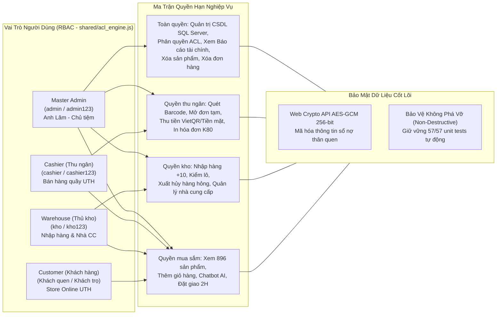

# SƠ ĐỒ KIẾN TRÚC HỆ THỐNG TẠP HÓA 36 (TAPHOA36 AI)
**Môn học:** Lập Trình Web — Trường Đại học Giao Thông Vận Tải TP.HCM (UTH)  
**Sinh viên thực hiện:** Trần Ngọc Lâm — MSSV: 034206001749  
**Cơ sở thực nghiệm:** Cửa Hàng Chính - Tạp Hóa 36 (UTH), 02 Võ Oanh, Thạnh Mỹ Tây, Bình Thạnh, TP.HCM  
**Công nghệ cốt lõi:** Multi-SPA Vanilla JS & Tailwind CSS | Node.js REST API | Microsoft SQL Server 2022 Developer Edition  

---

## 1. Sơ Đồ Khối Kiến Trúc Tổng Thể 3 Tầng (High-Performance 3-Tier Architecture)

Hệ thống được thiết kế theo mô hình 3 tầng hiện đại, phân tách độc lập giữa Tầng Trình Diễn (Presentation Layer), Tầng Dịch Vụ Nghiệp Vụ (Application / Service Layer) và Tầng Lưu Trữ Kép (Dual-Persistence Layer).



---

## 2. Sơ Đồ Luồng Dữ Liệu Giao Dịch & Đồng Bộ Thời Gian Thực (Transaction Sequence)

Quy trình xử lý một giao dịch bán hàng tại quầy POS hoặc đặt hàng trực tuyến trên Store Online, tự động trừ tồn kho và đồng bộ đa tab trong vòng dưới 50ms:



---

## 3. Sơ Đồ Thực Thể Quan Hệ Cơ Sở Dữ Liệu (Database ERD — SQL Server 2022)

Cơ sở dữ liệu quan hệ **`TapHoa36`** chuẩn hóa theo chuẩn Dạng Chuẩn 3 (3NF), gồm 6 thực thể chính đảm bảo toàn vẹn tham chiếu và kiểm toán dữ liệu:

```mermaid
erDiagram
    DANH_MUC ||--o{ SAN_PHAM : "chứa (1-n)"
    SAN_PHAM ||--o{ LO_HANG : "có lô nhập (1-n)"
    SAN_PHAM ||--o{ CHI_TIET_HOA_DON : "được bán trong (1-n)"
    LO_HANG ||--o{ CHI_TIET_HOA_DON : "xuất từ lô (1-n)"
    HOA_DON ||--|{ CHI_TIET_HOA_DON : "bao gồm chi tiết (1-n)"
    NHAN_VIEN ||--o{ HOA_DON : "lập hóa đơn (1-n)"
    NHAN_VIEN ||--o{ SAN_PHAM : "cập nhật cuối (1-n)"

    DANH_MUC {
        varchar(10) MaDanhMuc PK "Mã ngành hàng (DM01-DM15)"
        nvarchar(50) TenDanhMuc "Tên ngành hàng (Rau củ, Thịt cá, Gia vị...)"
        nvarchar(200) MoTa "Mô tả chi tiết nhóm hàng"
    }

    SAN_PHAM {
        varchar(15) MaSP PK "Mã vạch Barcode (EAN-13: 8936...)"
        nvarchar(150) TenSP "Tên mặt hàng tiêu dùng"
        varchar(10) MaDanhMuc FK "Tham chiếu bảng DANH_MUC"
        nvarchar(20) DonViTinh "Đơn vị tính (Hộp, Chai, Kg, Gói...)"
        decimal(18_2) GiaBan "Giá bán niêm yết tại quầy"
        bit LaHangTuoiSong "Cờ đánh dấu hàng tươi cần bảo quản lạnh"
        varchar(20) MaNVSuaCuoi FK "Mã nhân viên sửa đổi gần nhất"
        datetime NgaySuaCuoi "Dấu thời gian cập nhật"
    }

    LO_HANG {
        int MaLo PK "Mã lô hàng tự tăng (IDENTITY)"
        varchar(15) MaSP FK "Mã sản phẩm trong lô"
        date NgaySanXuat "Ngày sản xuất từ nhà cung cấp"
        date HanSuDung "Hạn sử dụng cảnh báo hết hạn"
        int SoLuongTon "Số lượng thực tế còn trong kho"
        decimal(18_2) GiaNhap "Giá vốn nhập kho từ NCC"
    }

    HOA_DON {
        varchar(20) MaHD PK "Mã hóa đơn duy nhất (HD_... hoặc #DH-...)"
        datetime NgayLap "Thời điểm thanh toán chính xác"
        decimal(18_2) TongTienHang "Tổng tiền trước chiết khấu"
        decimal(18_2) ThanhTien "Tổng tiền thực thu từ khách"
        nvarchar(50) PhuongThucTT "VietQR Napas 247 hoặc Tiền mặt COD"
        varchar(20) MaNV FK "Thu ngân thực hiện giao dịch"
    }

    CHI_TIET_HOA_DON {
        varchar(20) MaHD PK_FK "Tham chiếu HOA_DON"
        varchar(15) MaSP PK_FK "Tham chiếu SAN_PHAM"
        int MaLo FK "Tham chiếu lô xuất LO_HANG"
        decimal(10_2) SoLuong "Số lượng mua (hỗ trợ số thập phân cân ký)"
        decimal(18_2) DonGia "Đơn giá tại thời điểm bán"
        decimal(18_2) ThanhTien "Thành tiền của từng dòng hàng"
        decimal(18_2) SoTienGiam "Số tiền giảm giá / khuyến mãi"
    }

    NHAN_VIEN {
        varchar(20) MaNV PK "Tài khoản đăng nhập (admin, cashier...)"
        nvarchar(100) TenNV "Họ tên nhân viên UTH"
        varchar(20) VaiTro "Phân quyền: admin, cashier, warehouse, staff"
        varchar(100) MatKhau "Mật khẩu mã hóa / băm an toàn"
    }
```

---

## 4. Ma Trận Phân Quyền & Bảo Mật Hệ Thống (RBAC & Cryptography)



---

## 5. Bảng Đo Lường Chỉ Số Kỹ Thuật Thực Tế

| Thành Phần | Chỉ Số Thực Tế Đo Lường | Trạng Thái Kiểm Nghiệm |
| :--- | :--- | :--- |
| **Hệ Quản Trị CSDL** | Microsoft SQL Server 2022 (Developer Edition) | `ONLINE` (Cơ sở UTH) |
| **Tổng Danh Mục SP** | 896 sản phẩm thực tế thuộc 15 ngành hàng tiêu dùng | Đã nạp đầy đủ trong `dbo.SAN_PHAM` |
| **Tổng Số Hóa Đơn** | 12 hóa đơn thực tế (Đã làm sạch toàn bộ đơn rác) | Đồng bộ chuẩn trong `dbo.HOA_DON` |
| **Độ Trễ Đồng Bộ Đa Tab** | $< 50\text{ ms}$ qua `BroadcastChannel` | `AC-SYNC-02` (0ms measured) |
| **Thuật Toán Mã Hóa** | AES-GCM 256-bit qua chuẩn Web Crypto API | `AC-CRYPTO-01` to `03` PASS |
| **Bộ Kiểm Thử Tự Động** | **57/57 Unit Tests PASS (100% Xanh)** | `tests/run_cli_tests.js` |
| **Quy Chuẩn Giao Diện** | POS=PASS \| STORE=PASS \| ADMIN=PASS \| RULES=PASS | `tests/verify_ui.js` |
| **Phiên Bản Git Remote** | `https://github.com/huy26232/11-taphoa36.git` (Nhánh `main`) | Commit `5204bc6` |
