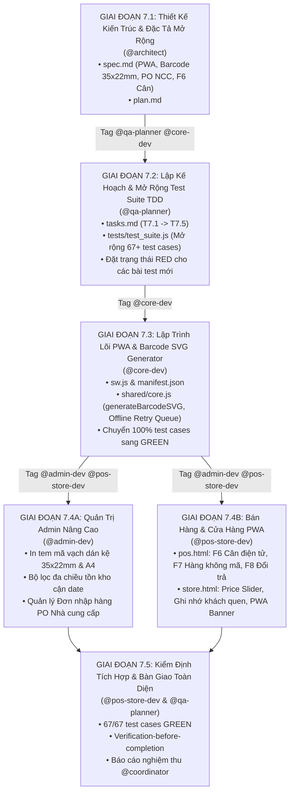

# 📅 KẾ HOẠCH TRIỂN KHAI DỰ ÁN "TẠP HÓA 36" (PROJECT IMPLEMENTATION PLAN)
## Đề tài: Ứng dụng Tạp Hóa theo Yêu Cầu cho Người Mới Bắt Đầu (TapHoa36 / TapHoa36 AI)
### Học phần: Lập trình Web | Khoa CNTT - Trường Đại học Giao thông vận tải TP.HCM (UTH) | Nhóm 11

---

## 1. TỔNG QUAN KẾ HOẠCH & MA TRẬN TRÁCH NHIỆM RACI

Để đảm bảo tính nhất quán kiến trúc, chất lượng mã nguồn cao nhất và tuân thủ nghiêm ngặt quy trình phát triển phần mềm chuẩn công nghiệp (Test-Driven Development - TDD): `spec.md ➔ plan.md ➔ tasks.md ➔ tests/ ➔ Code`, dự án được phân rã thành các giai đoạn tuần tự và song song giữa các Agent trong hệ thống Swarm.

### 1.1. Danh mục Nhân Sự Đồ Án Nhóm 11 & Phân Hệ Trách Nhiệm
| Thành viên thực hiện | Phân hệ chịu trách nhiệm | File triển khai chính | Công nghệ & Nhiệm vụ cốt lõi |
|---|---|---|---|
| **Trần Ngọc Lam** | **Admin Dashboard & Core Hub** | `admin.html`<br>`shared/core.js`<br>`server.js` | Trung tâm điều hành quản trị, Bento Grid 12 cột, thanh lọc bên trái, CSDL hạt nhân IndexedDB, mã hóa Web Crypto AES-GCM, phân quyền RBAC & ACL, MB Bank VietQR, Node.js API Server. |
| **Phạm Chấn Nguyên &<br>Nguyễn Minh Hiếu** | **POS (Bán hàng quầy thu ngân)** | `pos.html`<br>(từ `NguyenVaHieu/`) | Màn hình POS thu ngân chia đôi, đa tab đơn hàng (Đơn 1, 2, 3), quét mã vạch, phím tắt F1-F8, cân điện tử F6, hàng không mã F7, đổi trả F8, in hóa đơn nhiệt K80 chuẩn 80mm. |
| **Nguyễn Vương Quốc Huy (Leader) &<br>Võ Tuấn Kiệt** | **Store Online (Cửa hàng trực tuyến)** | `store.html`<br>(từ `KietVaHuy/`) | Giao diện E-commerce hiện đại, Hero Banner ưu đãi, thanh danh mục thường mua, phân loại 12 ngành hàng, Price Slider, giỏ hàng Drawer, Checkout giao hỏa tốc 2H, Chatbot thông minh TapHoa36 AI. |

### 1.2. Danh mục Nhân sự Swarm (Swarm Roster)
| Roster Name | Vai trò chuyên môn | Nhiệm vụ kỹ thuật cốt lõi |
|---|---|---|
| **@architect** (Agent 1) | Product Architect | Kiến trúc sư trưởng hệ thống; soạn thảo và cập nhật `spec.md`, `plan.md`, thiết kế mô hình PWA, Barcode SVG, Purchase Order workflow và API contracts. |
| **@qa-planner** (Agent 2) | Task Planner & QA Engineer | Quản lý tiến độ; mở rộng `tasks.md` và viết bộ kiểm thử tự động TDD (`tests/test_suite.js`, `tests/test_runner.html`, `run_cli_tests.js`) nâng lên 67+ test cases **TRƯỚC KHI VIẾT CODE**. |
| **@core-dev** (Agent 3) | Core Engine Developer | Lập trình `sw.js`, `manifest.json`, nâng cấp `shared/core.js` (Barcode SVG Generator Code128/EAN-13, Offline Sync Retry Queue với Exponential Backoff); bảo đảm 100% test cases pass (Red ➔ Green). |
| **@admin-dev** (Agent 4) | Admin Dashboard Specialist | Nâng cấp `admin.html`: Tích hợp in tem mã vạch dán kệ 35x22mm / A4, Quản lý Đơn nhập hàng PO Nhà cung cấp hạch toán Sổ Quỹ & Giá vốn bình quân, Bộ lọc đa chiều tồn kho cận date. |
| **@pos-store-dev** (Agent 5) | POS & Online Store Developer | Trong `pos.html`: Rà soát và kết nối F6 (Cân điện tử), F7 (Hàng không mã), F8 (Đổi trả hàng) với backend. Trong `store.html`: Bộ lọc trượt khoảng giá (Price Slider), ghi nhớ thông tin khách quen, Banner cài PWA. |
| **@monitor** (Agent 6) | Swarm Stall Monitor | Giám sát trạng thái Swarm, phát hiện và tháo gỡ tắc nghẽn (stall) nếu có agent bị đình trệ. |
| **@coordinator** | Swarm Coordinator | Điều phối tổng thể, giao brief, nghiệm thu sản phẩm cuối cùng và báo cáo Người dùng (User). |

---

### 1.3. Ma trận Phân bổ Trách nhiệm RACI
*(R = Responsible: Người trực tiếp thực hiện; A = Accountable: Người chịu trách nhiệm phê duyệt; C = Consulted: Người được tham vấn; I = Informed: Người được thông báo kết quả)*

| Hạng mục / Giao phẩm (Deliverable) | @architect | @qa-planner | @core-dev | @admin-dev | @pos-store-dev | @coordinator |
|---|:---:|:---:|:---:|:---:|:---:|:---:|
| **Bản đặc tả kỹ thuật `spec.md` (Mở rộng PWA, Barcode, PO)** | **R / A** | C | I | I | I | I |
| **Kế hoạch triển khai `plan.md` (Chiến dịch R&D Marathon)** | **R / A** | C | I | I | I | I |
| **Danh mục nhiệm vụ `tasks.md` (WBS mở rộng)** | C | **R / A** | I | I | I | I |
| **Bộ kiểm thử TDD `tests/test_suite.js` (67+ test cases)** | C | **R / A** | C | I | I | I |
| **Trình chạy test `tests/test_runner.html` & `run_cli_tests.js`** | C | **R / A** | I | I | I | I |
| **Module lõi hạt nhân `shared/core.js` + `sw.js` + `manifest.json`** | C | C | **R / A** | I | I | I |
| **Bảng quản trị Bento Grid `admin.html` (Tem kệ & PO NCC)** | C | I | C | **R / A** | I | I |
| **Màn hình bán hàng quầy `pos.html` (F6 Cân điện tử, F7, F8)** | C | I | C | I | **R / A** | I |
| **Cửa hàng online dân cư `store.html` (Price Slider & PWA)** | C | I | C | I | **R / A** | I |
| **Báo cáo kiểm thử & Nghiệm thu toàn diện (67/67 GREEN)** | I | C | I | I | **R** | **A** |

---

## 2. QUY TRÌNH TRIỂN KHAI THEO GIAI ĐOẠN (PHASED WORKFLOW)



---

### GIAI ĐOẠN 7.1: THIẾT KẾ KIẾN TRÚC & ĐẶC TẢ KỸ THUẬT MỞ RỘNG
- **Chủ trì:** `@architect` (Product Architect)
- **Đầu ra (Deliverables):**
  1. `spec.md`: Bản đặc tả kỹ thuật chi tiết toàn diện bổ sung:
     - Kiến trúc Offline-First PWA (`sw.js`, `manifest.json`, Stale-While-Revalidate, Background Sync Exponential Backoff).
     - Mô-đun Barcode Shelf Label Generator (Code128 / EAN-13 SVG thuần, khổ decal 35x22mm và trang A4 chia lưới).
     - Quản lý Đơn nhập hàng Nhà cung cấp (Purchase Order Lifecycle) đồng bộ Sổ Quỹ và tự động tính giá vốn bình quân gia quyền.
     - Tích hợp cân điện tử POS và bóc tách mã vạch trọng lượng tiền tố `20` / `21`.
     - 10 tiêu chí nghiệm thu mới: `AC-PWA-01..03`, `AC-LABEL-01..03`, `AC-PO-01..03`, `AC-SCALE-01` (nâng tổng số lên 67 test cases).
  2. `plan.md`: Bản kế hoạch triển khai chi tiết chiến dịch R&D Marathon.
- **Bàn giao (Handoff):** Post thông báo lên Swarm Message Board cho `@coordinator`, `@qa-planner`, và `@core-dev`.

---

### GIAI ĐOẠN 7.2: LẬP KẾ HOẠCH NHIỆM VỤ & VIẾT BỘ TEST TDD MỞ RỘNG
- **Chủ trì:** `@qa-planner` (Task Planner & QA Engineer)
- **Điều kiện tiên quyết:** `@architect` hoàn tất `spec.md` và `plan.md`.
- **Nhiệm vụ cụ thể:**
  1. Cập nhật `tasks.md` chi tiết hóa các hạng mục công việc WBS mới.
  2. Mở rộng `tests/test_suite.js`: Viết thêm 10 bài test TDD mới cho:
     - `AC-PWA-01..03`: Kiểm tra cấu hình manifest.json, service worker precaching và caching strategy.
     - `AC-LABEL-01..03`: Kiểm tra hàm sinh SVG barcode Code128/EAN-13, cấu trúc tem 35x22mm và in hàng loạt.
     - `AC-PO-01..03`: Kiểm tra tính toán đơn nhập PO, cập nhật tồn kho & giá vốn bình quân, hạch toán phiếu Chi Sổ Quỹ.
     - `AC-SCALE-01`: Kiểm tra bóc tách mã vạch cân điện tử tiền tố 20/21 và tính thành tiền.
  3. Khởi chạy `tests/run_cli_tests.js` xác nhận các test case mới đang ở trạng thái **RED**, giữ vững 57 test cũ luôn **GREEN**.
- **Bàn giao (Handoff):** Tag `@core-dev` trên Message Board để bắt đầu triển khai code.

---

### GIAI ĐOẠN 7.3: LẬP TRÌNH LÕI PWA & BARCODE SVG ENGINE
- **Chủ trì:** `@core-dev` (Core Engine Developer)
- **Điều kiện tiên quyết:** `@qa-planner` hoàn tất bộ test suite mở rộng.
- **Nhiệm vụ cụ thể:**
  1. Tạo `manifest.json` chuẩn PWA Native App: name `Tạp Hóa 36`, display `standalone`, shortcuts điều hướng.
  2. Tạo `sw.js` (Service Worker): Caching App Shell, Stale-While-Revalidate cho API, Offline Retry Queue.
  3. Nâng cấp `shared/core.js`:
     - Bổ sung `generateBarcodeSVG(code, type, options)` xuất chuỗi SVG Code128 / EAN-13 thuần túy không cần thư viện ngoài.
     - Bổ sung `poModule` (Tạo đơn PO, chuyển trạng thái `received` tự động cập nhật tồn kho và giá vốn bình quân, tự động chi tiền mặt vào Sổ Quỹ).
     - Bổ sung thuật toán Exponential Backoff tự động retry đẩy đơn hàng lên `/api/orders` khi mạng online.
  4. Chạy `tests/run_cli_tests.js` cho đến khi **100% test cases (67/67) chuyển sang màu XANH (GREEN)**.
- **Bàn giao (Handoff):** Tag `@admin-dev` và `@pos-store-dev` để bắt đầu tích hợp UI.

---

### GIAI ĐOẠN 7.4: PHÁT TRIỂN SONG SONG GIAO DIỆN & TÍCH HỢP UI

#### Nhánh 7.4A: Bảng Quản Trị `admin.html`
- **Chủ trì:** `@admin-dev` (Admin Dashboard Specialist)
- **Nhiệm vụ:**
  1. Tích hợp chức năng **"In tem mã vạch dán kệ"**:
     - Cho phép chọn nhiều sản phẩm trong bảng kho, nhập số lượng tem cần in cho từng sản phẩm.
     - Định dạng tem chuẩn 35x22mm (tiêu đề Tạp Hóa 36, tên hàng, giá to đậm, SVG barcode, ĐVT) hoặc trang A4 chia lưới 3x10.
     - Cửa sổ preview in ấn `@media print` đạt chuẩn máy in nhiệt tem nhãn XP-350B.
  2. Nâng cấp bộ lọc đa chiều trong bảng kho: Lọc nhanh hàng sắp hết tồn kho (< 10), hàng cận date ($\le 5$ ngày), khoảng giá.
  3. Hoàn thiện Modal **"Tạo Đơn Nhập Hàng (Purchase Order)"**: Chọn nhà cung cấp, chọn danh sách hàng nhập, tự động tính tổng tiền, thanh toán tiền mặt (hạch toán Sổ Quỹ) hoặc ghi nợ NCC.

#### Nhánh 7.4B: Thu Ngân `pos.html` & Cửa Hàng `store.html`
- **Chủ trì:** `@pos-store-dev` (POS & Online Store Developer)
- **Nhiệm vụ:**
  1. Trong `pos.html`:
     - Rà soát và kết nối trơn tru các tính năng phím tắt: `F6` (Cân điện tử - bóc tách mã vạch cân GS1 tiền tố 20/21), `F7` (Hàng không mã), `F8` (Đổi trả hàng) kết nối trực tiếp với backend.
  2. Trong `store.html`:
     - Tích hợp **Bộ lọc trượt khoảng giá (Price Slider)** mượt mà từ 0đ đến 500.000đ.
     - Tự động ghi nhớ thông tin giao hàng khách quen vào LocalStorage.
     - Tích hợp Banner cài đặt PWA Native App (`beforeinstallprompt`).

---

### GIAI ĐOẠN 7.5: KIỂM ĐỊNH TOÀN DIỆN & NGHIỆM THU DỰ ÁN
- **Chủ trì:** `@pos-store-dev` & `@qa-planner`
- **Nhiệm vụ:**
  1. Chạy toàn bộ test suite CLI: `node tests/run_cli_tests.js` (Bảo đảm 67/67 tests PASSED).
  2. Chạy test giao diện: `node tests/verify_ui.js` (Bảo đảm POS=PASS | STORE=PASS | ADMIN=PASS).
  3. Mở `tests/test_runner.html` trên trình duyệt xác nhận 100% tests GREEN.
  4. Báo cáo nghiệm thu toàn diện gửi `@coordinator`.

---

## 3. PHÂN RÃ CÔNG VIỆC CHI TIẾT (WORK BREAKDOWN STRUCTURE - WBS)

```
WBS T1: THƯ VIỆN HẠT NHÂN DÙNG CHUNG (shared/core.js + sw.js + manifest.json)
├── T1.1: Storage Engine DAL (IndexedDB TapHoaSoDB 8 Stores & LocalStorage Cache)
├── T1.2: Real-time Multi-tab Sync Engine (BroadcastChannel 'taphoaso_bus' & Storage fallback)
├── T1.3: Web Crypto API AES-GCM Module (Mã hóa / Giải mã Sổ nợ & PII)
├── T1.4: Export & Print Services (Excel UTF-8 BOM, PDF Generator, Print K80 CSS)
├── T1.5: Auth & RBAC Manager (Mock OAuth2 Google/FB, Session, ProtectPage, QuickSwitcher)
├── T1.6: AI Backend Engine (NLP Tiếng Việt, Intent Classifier 10 nhóm, Recommender, Dynamic Pricing)
├── T1.7: Barcode SVG Generator (Code128 / EAN-13 Vector siêu nhẹ < 2KB, không phụ thuộc thư viện ngoài)
├── T1.8: PWA Service Worker (sw.js) & Web App Manifest (manifest.json) precache App Shell
└── T1.9: Offline Mutation Retry Queue với thuật toán Exponential Backoff (1s, 2s, 4s, 8s, max 30s)

WBS T2: BỘ KIỂM THỬ TỰ ĐỘNG TDD (tests/)
├── T2.1: Bộ Test Suite Khung (describe, it, expect assertions)
├── T2.2: Test Cases Nhóm Auth & RBAC (AC-AUTH-01 -> 06)
├── T2.3: Test Cases Nhóm Real-time Sync & Storage (AC-SYNC-01 -> 04, AC-DAL-01 -> 05)
├── T2.4: Test Cases Nhóm Web Crypto & Export (AC-CRYPTO-01 -> 03, AC-EXPORT-01 -> 04)
├── T2.5: Test Cases Nhóm AI Engine (AC-AI-01 -> 04)
├── T2.6: Test Cases Nhóm Bán Hàng POS & Quản Trị Admin (AC-POS-01 -> 06, AC-ADMIN-01 -> 09)
├── T2.7: Test Cases Nhóm Phân Quyền ACL & Vòng Đời Kho Sạch (AC-ACL-01 -> 05, AC-CLEAN-01 -> 03)
├── T2.8: Test Cases Nhóm Kho Mở Rộng & Điều Chuyển (AC-WH-01 -> 05, AC-SUPP-01, AC-EXP-01, AC-API-01)
├── T2.9: Test Cases Nhóm PWA & Offline Caching (AC-PWA-01 -> 03)
├── T2.10: Test Cases Nhóm Tem Kệ Hàng Barcode SVG (AC-LABEL-01 -> 03)
├── T2.11: Test Cases Nhóm Đơn Nhập Hàng NCC & Giá Vốn Bình Quân (AC-PO-01 -> 03)
└── T2.12: Test Cases Nhóm Cân Điện Tử POS (AC-SCALE-01)

WBS T3: BẢNG QUẢN TRỊ CỬA HÀNG (admin.html)
├── T3.1: Hợp nhất toàn vẹn 6 views gốc theo Non-destructive Rule (Image 2, 4, 6, 8, 10, 12)
├── T3.2: Top Horizontal Navbar chuẩn TapHoa36 (Logo UTH, Hotline 1900 6522, Cơ sở chính UTH, Nút trắng F1 Bán hàng)
├── T3.3: Tách biệt cấu hình phức tạp vào Modal Cài Đặt (Settings Modal ⚙️) để giao diện cực kỳ CLEAN
├── T3.4: Chức năng dọn dẹp dữ liệu ("🧹 Xóa sạch dữ liệu mẫu" clearAllData) và form "+ Thêm mới" sản phẩm
├── T3.5: Mô-đun In Tem Mã Vạch Dán Kệ Hàng: Khổ 35x22mm & A4, in hàng loạt tem nhãn sắc nét
├── T3.6: Bộ lọc đa chiều: Lọc nhanh hàng sắp hết kho (< 10), hàng cận date, khoảng giá
└── T3.7: Modal Quản lý Đơn nhập hàng Nhà cung cấp (Purchase Order): Cập nhật tồn kho, giá vốn bình quân, chi Sổ Quỹ

WBS T4: MÀN HÌNH THU NGÂN TẠI QUẦY (pos.html)
├── T4.1: Bố cục chia đôi màn hình ngang 2 cột Widescreen / Tablet
├── T4.2: Lưới danh mục sản phẩm, phím tắt món bán chạy & Barcode scanner input
├── T4.3: Hóa đơn hiện tại, tính tiền thối tự động, tạo mã VietQR NAPAS 247 động
├── T4.4: Module ghi nợ sổ quen xóm & Hệ thống phím tắt thu ngân: F1, F2, F3, F4, ESC
├── T4.5: Tích hợp F6 (Cân điện tử & bóc tách mã vạch cân GS1 tiền tố 20/21)
├── T4.6: Tích hợp F7 (Hàng không mã) & F8 (Đổi trả hàng) kết nối trực tiếp với backend
├── T4.7: Mẫu in hóa đơn nhiệt K80 chuẩn 80mm (@page { size: 80mm auto; margin: 0; })
└── T4.8: Nút chuyển về Admin (kiểm tra quyền RBAC Admin)

WBS T5: CỬA HÀNG TRỰC TUYẾN DÂN CƯ (store.html)
├── T5.1: Giao diện mua sắm tối giản, tải siêu tốc (< 0.2s), tương thích Mobile-First
├── T5.2: Trưng bày 12 ngành hàng thiết yếu & đồng bộ tồn kho thời gian thực (< 50ms)
├── T5.3: Bộ lọc trượt khoảng giá (Price Slider) từ 0đ đến 500.000đ
├── T5.4: Ngăn kéo giỏ hàng (Cart Drawer) & Modal thanh toán 1 bước (Ship 2H)
├── T5.5: Đăng nhập xã hội Mock OAuth2 (Google & Facebook popup)
├── T5.6: Tự động ghi nhớ thông tin giao hàng khách quen vào LocalStorage
├── T5.7: RBAC Router Guard: Ẩn hoàn toàn Quick Switcher / nút sang Admin & POS với khách thường
├── T5.8: Floating Chatbot Trợ lý ảo TapHoa36 AI hỗ trợ tìm kiếm giọng nói & tiếng Việt
└── T5.9: Banner nhắc cài đặt ứng dụng PWA Native App về màn hình chính
```

---

## 4. QUẢN TRỊ RỦI RO & PHƯƠNG ÁN DỰ PHÒNG (RISK MATRIX)

| Mã Rủi ro | Mô tả Rủi ro Kỹ thuật | Mức độ | Phương án Ứng phó & Xử lý Ngoại lệ |
|:---:|---|:---:|---|
| **R-01** | Vi phạm **Non-destructive Rule** làm mất thẻ HTML hoặc style gốc từ 6 file Image khi merge `admin.html`. | **RẤT CAO** | `@admin-dev` phải nhúng toàn bộ các phân đoạn HTML gốc vào từng tab tương ứng trong `admin.html`, kiểm tra đối chiếu từng ID và class gốc trước khi tích hợp. |
| **R-02** | Xung đột đồng bộ (Race Condition) khi POS và Store cùng bán 1 sản phẩm cuối cùng trong kho cùng lúc. | **TRUNG BÌNH** | Tầng DAL trong `shared/core.js` sử dụng cờ Mutex kiểm tra tồn kho tại thời điểm commit giao dịch; nếu tồn $< \text{SL mua}$, từ chối đơn sau và thông báo tức thì. |
| **R-03** | Service Worker cache giữ phiên bản cũ không cập nhật mã nguồn mới. | **TRUNG BÌNH** | Sử dụng cơ chế versioning cache `taphoa36-static-v2`, `self.skipWaiting()` khi install và `clients.claim()` khi activate để cập nhật ngay lập tức. |
| **R-04** | Trình duyệt cũ hoặc chế độ ẩn danh không hỗ trợ `BroadcastChannel` hoặc `IndexedDB`. | **THẤP** | Tự động kích hoạt cơ chế Fallback sang `localStorage` và sự kiện `storage`, đảm bảo ứng dụng không bao giờ bị Crash. |
| **R-05** | Mã vạch in ra bị mờ hoặc vỡ nét khi dùng máy in nhiệt decal cuộn 35x22mm. | **TRUNG BÌNH** | Sinh mã vạch dạng SVG vector thuần túy thay vì canvas/bitmap, giữ tỷ lệ module chuẩn 1px để đầu in nhiệt 203 DPI / 300 DPI quét chính xác 100%. |
| **R-06** | Khách hàng mua sắm online tình cờ nhìn thấy hoặc bấm sang trang Quản trị / Thu ngân. | **CAO** | Áp dụng 2 lớp bảo vệ: (1) Lớp UI: Ẩn hoàn toàn nút chuyển trang trên giao diện `store.html`; (2) Lớp Route Guard: `TapHoaCore.auth.protectPage()` tự động đá văng về `store.html` nếu không có quyền. |

---

## 5. TIÊU CHUẨN HOÀN THÀNH (DEFINITION OF DONE - DOD)

Một gói công việc hoặc toàn bộ dự án chỉ được coi là **HOÀN THÀNH (DONE)** khi thỏa mãn đầy đủ các điều kiện sau:
1. **100% Test Cases Pass (67/67 GREEN):** Toàn bộ các bài kiểm tra trong `tests/run_cli_tests.js` và `tests/test_runner.html` đều đạt màu Xanh (Passed), 0 test case bị Failed.
2. **Tuân thủ Non-destructive Rule:** Tệp `admin.html` lưu giữ trọn vẹn 100% nội dung và tính năng từ 6 tệp mẫu `Image 2, 4, 6, 8, 10, 12.html`.
3. **PWA Hoạt Động Trơn Tru:** File `sw.js` và `manifest.json` hợp lệ, hỗ trợ duyệt offline và cài đặt về màn hình chính.
4. **Tem Kệ Mã Vạch Chuẩn Xác:** Hàm `generateBarcodeSVG` sinh mã vạch vector chuẩn in tem nhãn 35x22mm và trang A4.
5. **Đơn Nhập Hàng Tự Động Hóa:** Chuyển trạng thái đơn PO tự động cập nhật tồn kho, giá vốn bình quân và phiếu Chi trong Sổ Quỹ.
6. **Bảo Mật Phân Quyền Tuyệt Đối:** Khách hàng không thể can thiệp vào trang Admin/POS; Sổ nợ được mã hóa AES-GCM an toàn.
7. **Đồng Bộ Đa Tab Tức Thì:** Giao dịch tại POS phản ánh sang tồn kho Store trong thời gian $< 50\text{ms}$.
8. **In Hóa Đơn & Xuất Báo Cáo Chuẩn:** Hóa đơn in ra đúng khổ nhiệt K80 80mm; file Excel không lỗi font chữ tiếng Việt.

---

*Kế hoạch này có hiệu lực ngay lập tức và được phân phối tới tất cả thành viên trong Swarm.*
