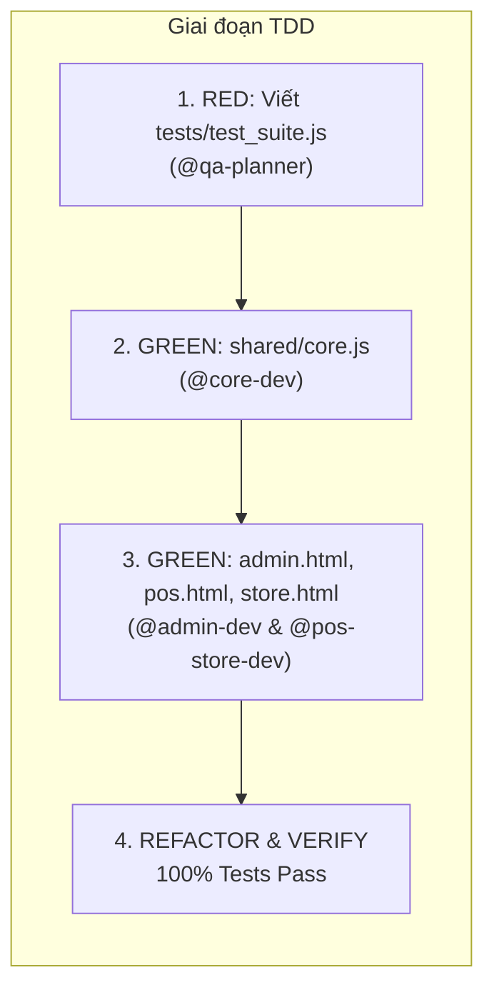

# 📋 BẢNG PHÂN RÃ NHIỆM VỤ DỰ ÁN "TẠP HÓA SỐ" (TASKS BREAKDOWN - TDD WORKFLOW)
## Đề tài: Ứng dụng Tạp Hóa theo Yêu Cầu cho Người Mới Bắt Đầu (TạpHóa Online / TapHoa36)
### Học phần: Lập trình Web | Khoa CNTT - UTH | Nhóm 11 | Agent phụ trách: @qa-planner

---

## 1. TỔNG QUAN PHÂN RÃ CÔNG VIỆC

Quy trình triển khai tuân thủ nghiêm ngặt phương pháp **Test-Driven Development (TDD)**:
1. **Red Stage**: `@qa-planner` xác định nhiệm vụ, viết bộ kiểm thử tự động `tests/test_suite.js` và trình chạy `tests/test_runner.html` bao phủ 100% tiêu chí nghiệm thu (AC). Tại thời điểm ban đầu, các test case sẽ có trạng thái **RED (Failed)** do chưa có mã nguồn cài đặt.
2. **Green Stage**: `@core-dev`, `@admin-dev`, `@pos-store-dev` phát triển mã nguồn tương ứng (`shared/core.js`, `admin.html`, `pos.html`, `store.html`) cho đến khi 100% test case chuyển sang **GREEN (Passed)**.
3. **Refactor & Verification Stage**: Tối ưu hóa hiệu năng, xác thực đồng bộ thời gian thực đa tab và lập báo cáo nghiệm thu gửi `@coordinator`.



---

## 2. MA TRẬN NHIỆM VỤ CỐT LÕI (TASKS T1, T2, T3)

### NHÓM NHIỆM VỤ T1: HẠT NHÂN HỆ THỐNG & DỊCH VỤ DÙNG CHUNG (CORE ENGINE SERVICES)
**Agent phụ trách chính:** `@core-dev`  
**File đích:** `shared/core.js`  
**Bộ test liên kết:** `AC-DAL`, `AC-SYNC`, `AC-CRYPTO`, `AC-EXPORT`

| Mã Task | Tên Nhiệm Vụ Chi Tiết | Mô Tả Kỹ Thuật & Yêu Cầu | Tiêu Chí Nghiệm Thu (AC) | Phụ Thuộc |
|---|---|---|---|:---:|
| **T1.1** | **Storage DAL Engine (IndexedDB + Cache)** | Xây dựng wrapper IndexedDB `TapHoaSoDB` v1 với 6 Object Stores: `products`, `orders`, `debts`, `cash_flows`, `settings`, `offline_queue`. Tích hợp cơ chế tự động nạp dữ liệu mẫu (Seeding) $\ge 30$ sản phẩm thuộc 12 ngành hàng thiết yếu khi mở ứng dụng lần đầu. Quản lý trạng thái ngoại tuyến (`offline_queue`). | `AC-DAL-01`<br>`AC-DAL-02`<br>`AC-DAL-03`<br>`AC-DAL-04` | Không |
| **T1.2** | **Real-time Multi-tab Sync Engine** | Khởi tạo kênh sự kiện `BroadcastChannel('taphoaso_bus')` cho phép truyền thông điệp liên tab với độ trễ $< 50\text{ms}$. Tích hợp cơ chế Fallback sang `window.addEventListener('storage')` và `localStorage` khi môi trường không hỗ trợ `BroadcastChannel`. Hỗ trợ các sự kiện: `PRODUCT_STOCK_CHANGED`, `ORDER_CREATED`, `DEBT_RECORD_UPDATED`, `INVENTORY_MIN_STOCK_ALERT`, `USER_AUTH_CHANGED`. | `AC-SYNC-01`<br>`AC-SYNC-02`<br>`AC-SYNC-03`<br>`AC-SYNC-04` | T1.1 |
| **T1.3** | **Web Crypto API AES-GCM 256-bit** | Sử dụng Web Crypto API chuẩn (`window.crypto.subtle`) cài đặt thuật toán mã hóa đối xứng AES-GCM 256-bit kết hợp IV ngẫu nhiên 12 bytes. Sinh khóa dẫn xuất từ mật khẩu quản trị qua PBKDF2 (SHA-256, 100.000 vòng lặp). Mã hóa các trường thông tin nhạy cảm của khách hàng trong Sổ nợ (`debts`) và PII (địa chỉ, SĐT). Giải mã hiển thị khi có xác thực admin. | `AC-CRYPTO-01`<br>`AC-CRYPTO-02`<br>`AC-CRYPTO-03` | Không |
| **T1.4** | **Export & Receipt Print Engine** | Xây dựng chức năng xuất Excel bảng tính tiếng Việt chuẩn UTF-8 BOM (`\uFEFF`) chống lỗi phông chữ (Mojibake). Xây dựng hàm tạo báo cáo PDF chuyên nghiệp. Cài đặt hàm in hóa đơn nhiệt K80 chuẩn 80mm (`@page { size: 80mm auto; margin: 0; }`) bao gồm đầy đủ header tiệm, chi tiết đơn, tiền thối và mã QR. | `AC-EXPORT-01`<br>`AC-EXPORT-02`<br>`AC-EXPORT-03` | T1.1 |
| **T1.5** | **Clear All Data & Real Catalog Seeder** | Bổ sung hàm `clearAllData()` xóa sạch dữ liệu trong IndexedDB/Storage để người dùng tự nhập dữ liệu thực tế của họ. Cung cấp danh mục hàng hóa thực tế (TopGia, Omachi, Celano, Cafe sữa, Nước suối...). | `AC-DAL-05` | T1.1 |

---

### NHÓM NHIỆM VỤ T2: BẢO MẬT PHÂN QUYỀN & ĐỘNG CƠ TRÍ TUỆ NHÂN TẠO CÔ BA AI
**Agent phụ trách chính:** `@core-dev`  
**File đích:** `shared/core.js`  
**Bộ test liên kết:** `AC-AUTH`, `AC-AI`

| Mã Task | Tên Nhiệm Vụ Chi Tiết | Mô Tả Kỹ Thuật & Yêu Cầu | Tiêu Chí Nghiệm Thu (AC) | Phụ Thuộc |
|---|---|---|---|:---:|
| **T2.1** | **Xác thực Tài khoản & Mock OAuth2** | Thiết lập 4 tài khoản mặc định có sẵn trong hệ thống: `admin` (role: `admin`), `staff` (role: `cashier`), `khachhang1` và `khachhang2` (role: `customer`). Xây dựng hàm `loginOAuth(provider)` mô phỏng modal đăng nhập nhanh bằng Google và Facebook 1-chạm, tự động cấp quyền `customer`. Quản lý phiên làm việc Session và phát sự kiện `USER_AUTH_CHANGED`. | `AC-AUTH-01`<br>`AC-AUTH-02` | T1.2 |
| **T2.2** | **RBAC Matrix, Route Guard & Quick Switcher** | Xây dựng hàm điều hướng bảo vệ trang `TapHoaCore.auth.protectPage(allowedRoles, redirectUrl)`. Tự động chặn và redirect về `store.html` nếu tài khoản `customer` hoặc khách vãng lai cố truy cập `admin.html` hoặc `pos.html`. Cài đặt hàm `renderQuickSwitcher(containerId)`: Ẩn hoàn toàn switcher đối với `customer`; hiển thị Store + POS đối với `cashier`; hiển thị Store + POS + Admin đối với `admin`. | `AC-AUTH-03`<br>`AC-AUTH-04`<br>`AC-AUTH-05` | T2.1 |
| **T2.3** | **NLP Pipeline Tiếng Việt & 10 Intent Groups** | Xây dựng module xử lý ngôn ngữ tự nhiên: hàm `normalize()` khử dấu thanh tiếng Việt Unicode NFD (ví dụ: "Thịt ba rọi rút sườn" ➔ "thit ba roi rut suon"). Xây dựng thuật toán phân loại ý định `classifyIntent(query)` nhận diện chính xác 10 nhóm ý định người dùng với độ tin cậy $\ge 0.85$ (GREETING, FIND_PRODUCT, PRICE_INQUIRY, CHECK_ORDER, SHIPPING_POLICY, PAYMENT_METHODS, PROMOTION_DEALS, RETURN_POLICY, DEBT_INQUIRY, THANKS). Cài đặt hàm trích xuất thực thể `extractEntities()`. | `AC-AI-01`<br>`AC-AI-02`<br>`AC-AI-03` | Không |
| **T2.4** | **Hybrid Recommender & Dynamic Pricing** | Cài đặt thuật toán gợi ý hàng hóa cá nhân hóa kết hợp trọng số tương tác: View (1), Cart (3), Purchase (5) và vector sở thích ngành hàng. Cài đặt thuật toán đề xuất giảm giá xả hàng tự động (Dynamic Pricing Optimizer) cho các sản phẩm cận hạn sử dụng ($\le 5$ ngày) hoặc tồn kho cao. | `AC-AI-04`<br>`AC-ADMIN-07` | T1.1, T2.3 |

---

### NHÓM NHIỆM VỤ T3: GIAO DIỆN NGƯỜI DÙNG & TÍCH HỢP ĐA KÊNH
**Agent phụ trách chính:** `@admin-dev` & `@pos-store-dev`  
**File đích:** `admin.html`, `pos.html`, `store.html`  
**Bộ test liên kết:** `AC-POS`, `AC-ADMIN`, `AC-AUTH`, `AC-SYNC`

| Mã Task | Tên Nhiệm Vụ Chi Tiết | Mô Tả Kỹ Thuật & Yêu Cầu | Tiêu Chí Nghiệm Thu (AC) | Phụ Thuộc |
|---|---|---|---|:---:|
| **T3.1** | **Bảng Quản Trị Bento Grid (`admin.html`)** | Áp dụng nghiêm ngặt **NON-DESTRUCTIVE RULE**: Tích hợp và bảo toàn 100% nội dung, kiểu dáng, cấu trúc từ 6 tệp mẫu `d:\download\Image 2, 4, 6, 8, 10, 12.html` vào 6 tab tương ứng. Xây dựng bố cục Bento Grid 12 cột Widescreen. Nhúng Quick Switcher nổi bật trên Header (có RBAC guard). Tích hợp Dark Mode toàn cục, Network Status Pill, nút `+10` nhập nhanh, giải mã Sổ nợ và xuất file Excel/PDF thật. | `AC-ADMIN-01`<br>`AC-ADMIN-02`<br>`AC-ADMIN-03`<br>`AC-ADMIN-04`<br>`AC-ADMIN-05`<br>`AC-ADMIN-06`<br>`AC-ADMIN-07`<br>`AC-ADMIN-08` | T1, T2 |
| **T3.2** | **Màn Hình Thu Ngân Bán Lẻ (`pos.html`)** | Thiết kế giao diện Desktop chia đôi 2 cột (Trái: Lưới mặt hàng bán chạy + ô quét Barcode; Phải: Hóa đơn bán lẻ + thanh toán). Hỗ trợ 3 phương thức thanh toán: Tiền mặt tính tiền thối tự động, VietQR động chuẩn NAPAS, Ghi nợ sổ quen xóm. In hóa đơn nhiệt K80 80mm ngay sau khi thanh toán. Cài đặt hệ thống phím tắt `F1`, `F2`, `F3`, `F4`, `ESC`. Nút chuyển về Admin được bảo vệ bởi RBAC guard. | `AC-POS-01`<br>`AC-POS-02`<br>`AC-POS-03`<br>`AC-POS-04`<br>`AC-POS-05`<br>`AC-POS-06` | T1, T2 |
| **T3.3** | **Cửa Hàng Dân Cư Siêu Tốc (`store.html`)** | Thiết kế giao diện mua sắm tối giản cho người mới bắt đầu, tốc độ tải $< 0.2\text{s}$. Trưng bày 12 ngành hàng thiết yếu. Nhận sự kiện đồng bộ tồn kho thực qua `BroadcastChannel` (khóa nút mua khi hết hàng trong $< 50\text{ms}$). Ngăn kéo giỏ hàng Slide-out Cart Drawer và Modal thanh toán 1 bước (Ship 2H). Tích hợp tìm kiếm giọng nói Web Speech API và Floating Chatbot Cô Ba AI. **ẨN HOÀN TOÀN** mọi liên kết sang Admin/POS với tài khoản khách thường. | `AC-AUTH-03`<br>`AC-AUTH-04`<br>`AC-SYNC-01`<br>`AC-SYNC-02`<br>`AC-SYNC-03`<br>`AC-AI-01`<br>`AC-AI-02` | T1, T2 |
| **T3.4** | **Redesign Top Horizontal Navbar TapHoa36 (`admin.html`)** | Redesign thanh điều hướng menu hàng ngang chuẩn TapHoa36: Tầng 1 (Logo, Hotline 1900 6522, Chi nhánh Cửa Hàng Chính - 02 Võ Oanh, Thạnh Mỹ Tây, UTH, Chuông, Modal Cài đặt ⚙️ có nút "Xóa sạch dữ liệu mẫu", User Profile); Tầng 2 (Menu xanh #0070e0 với các tab dropdown; góc phải là nút trắng "🛒 Bán hàng" F1 -> pos.html). | `AC-ADMIN-09` | T1.5, T3.1 |
| **T3.5** | **Tích hợp POS Hiện Đại từ Nguyên & Hiếu (`pos.html`)** | Tích hợp các tính năng nổi bật từ `NguyenVaHieu/MayPOS-TapHoaSoupdate/MayPOS-TapHoaSo/banhang/`: giao diện quầy POS đa tab (Đơn 1, Đơn 2, Đơn 3), phím tắt thu ngân F2-F8, cân điện tử F6, hàng không mã F7, trả hàng F8, modal quản lý ca thu ngân (`pos_shift`). Đấu nối trực tiếp vào `TapHoaCore` (IndexedDB, Web Crypto, VietQR MB Bank, K80 in nhiệt). Gắn nhãn phụ trách: *Phạm Chấn Nguyên & Nguyễn Minh Hiếu*. | `AC-POS-01`<br>`AC-POS-02`<br>`AC-POS-03`<br>`AC-POS-04`<br>`AC-POS-05`<br>`AC-POS-06` | T1, T2, T3.2 |
| **T3.6** | **Tích hợp Store Online từ Kiệt & Huy (`store.html`)** | Tích hợp giao diện E-commerce siêu thị từ `KietVaHuy/public/assets/aistudio/trangchu.html`: Hero Banner ưu đãi, thanh danh mục thường mua, phân loại 6 ngành hàng, thanh tìm kiếm gợi ý từ khóa, giỏ hàng Drawer trượt và Checkout giao hỏa tốc 2H. Đấu nối đồng bộ tồn kho thực và Chatbot AI. Gắn nhãn phụ trách: *Nguyễn Vương Quốc Huy (Leader) & Võ Tuấn Kiệt*. | `AC-AUTH-03`<br>`AC-AUTH-04`<br>`AC-SYNC-01`<br>`AC-SYNC-02`<br>`AC-AI-01`<br>`AC-AI-02` | T1, T2, T3.3 |
| **T3.7** | **Universal App Switcher & Team Attribution Header** | Xây dựng thanh điều hướng chuyển đổi nhanh giữa 3 phân hệ (Admin - Trần Ngọc Lam, POS - Nguyên & Hiếu, Store - Kiệt & Huy) trên cả 3 trang (`admin.html`, `pos.html`, `store.html`), hiển thị nhãn vai trò từng thành viên, hỗ trợ 1-click chuyển đổi mượt mà. | `AC-AUTH-05`<br>`AC-ADMIN-08`<br>`AC-ADMIN-09` | T3.1, T3.5, T3.6 |

---

## 3. ĐẶC TẢ BỘ TEST TDD (`tests/test_suite.js`)

Bộ test suite được cấu trúc theo 8 module kiểm thử độc lập, tương ứng với toàn bộ mã nghiệm thu từ `AC-AUTH` đến `AC-ADMIN`:

```
tests/test_suite.js
├── Suite 1: Authentication & RBAC Module (AC-AUTH-01 -> 05)
│   ├── it('AC-AUTH-01: should authenticate hardcoded seed users with exact roles')
│   ├── it('AC-AUTH-02: should handle mock OAuth2 social login (Google & Facebook)')
│   ├── it('AC-AUTH-03: should protect admin/pos routes from unauthorized customer access')
│   ├── it('AC-AUTH-04: should strictly hide Quick Switcher for customer or guest role')
│   └── it('AC-AUTH-05: should render full 3-page Quick Switcher for admin role')
│
├── Suite 2: Real-time Multi-tab Sync Module (AC-SYNC-01 -> 04)
│   ├── it('AC-SYNC-01: should broadcast PRODUCT_STOCK_CHANGED payload on inventory delta')
│   ├── it('AC-SYNC-02: should receive and process sync events with low latency (<50ms)')
│   ├── it('AC-SYNC-03: should disable purchase actions when product stock reaches zero')
│   └── it('AC-SYNC-04: should provide functional StorageEvent fallback when BroadcastChannel is absent')
│
├── Suite 3: Offline-First Storage DAL Module (AC-DAL-01 -> 05)
│   ├── it('AC-DAL-01: should initialize TapHoaSoDB with all 6 required object stores')
│   ├── it('AC-DAL-02: should seed at least 30 essential products spanning 12 categories')
│   ├── it('AC-DAL-03: should queue orders in offline_queue when network is offline')
│   ├── it('AC-DAL-04: should flush and sync offline_queue once network recovers')
│   └── it('AC-DAL-05: should clear all mock data via clearAllData() for fresh user input')
│
├── Suite 4: Web Crypto API AES-GCM Module (AC-CRYPTO-01 -> 03)
│   ├── it('AC-CRYPTO-01: should encrypt sensitive debt and customer data with AES-GCM')
│   ├── it('AC-CRYPTO-02: should decrypt encrypted payloads back to original plain object')
│   └── it('AC-CRYPTO-03: should protect customer debts in storage requiring master key')
│
├── Suite 5: Export & Receipt Print Services (AC-EXPORT-01 -> 03)
│   ├── it('AC-EXPORT-01: should export CSV/Excel with UTF-8 BOM preventing mojibake')
│   ├── it('AC-EXPORT-02: should generate standard K80 receipt format conforming to 80mm roll')
│   └── it('AC-EXPORT-03: should format printable revenue report table')
│
├── Suite 6: Cô Ba AI NLP & Recommender Engine (AC-AI-01 -> 04)
│   ├── it('AC-AI-01: should remove Vietnamese accents and normalize search terms')
│   ├── it('AC-AI-02: should accurately classify 10 distinct customer intent categories')
│   ├── it('AC-AI-03: should extract entity names and lookup catalog prices/stock')
│   └── it('AC-AI-04: should compute hybrid recommendation scores from customer behavior')
│
├── Suite 7: Cashier POS Business Logic (AC-POS-01 -> 06)
│   ├── it('AC-POS-01: should add matching product to cart upon barcode input')
│   ├── it('AC-POS-02: should calculate exact change immediately when cash is tendered')
│   ├── it('AC-POS-03: should generate valid NAPAS VietQR transfer string and code')
│   ├── it('AC-POS-04: should record encrypted customer debt transactions')
│   ├── it('AC-POS-05: should trigger keyboard shortcut actions for F1, F2, F3, F4, ESC')
│   └── it('AC-POS-06: should hide the Back to Admin button for non-admin accounts')
│
├── Suite 8: Admin Dashboard Integration (AC-ADMIN-01 -> 09)
│   ├── it('AC-ADMIN-01: should verify integrity of 6 merged views under Non-Destructive Rule')
│   ├── it('AC-ADMIN-02: should toggle smoothly between all 6 functional views')
│   ├── it('AC-ADMIN-03: should support 12-column responsive Bento Grid layout')
│   ├── it('AC-ADMIN-04: should increment stock by +10 on fast intake action')
│   ├── it('AC-ADMIN-05: should persist global dark mode setting in storage')
│   ├── it('AC-ADMIN-06: should compute 4 financial metrics: Inflow, Outflow, Cash Drawer, Debt')
│   ├── it('AC-ADMIN-07: should suggest discount percentages for near-expiry products')
│   ├── it('AC-ADMIN-08: should enable instant navigation to Store and POS for Admin')
│   └── it('AC-ADMIN-09: should provide TapHoa36 Top Navbar config with hotline and POS link')
│
├── Suite 9: Access Control List & Audit Logs (AC-ACL-01 -> 05)
├── Suite 10: Clean State & Reset (AC-CLEAN-01 -> 03)
├── Suite Warehouse & Extended Supplier (AC-WH-01 -> 05, AC-SUPP-01, AC-EXP-01, AC-API-01)
│
├── Suite 11: Progressive Web App & Offline-First (AC-PWA-01 -> 03) [RED]
│   ├── it('AC-PWA-01: File manifest.json đầy đủ thông tin chuẩn PWA và cấu hình standalone')
│   ├── it('AC-PWA-02: Cấu hình Service Worker sw.js precaching App Shell đảm bảo mở trang offline')
│   └── it('AC-PWA-03: Caching Strategy Stale-While-Revalidate và Hàng đợi Offline Mutation Retry Queue')
│
├── Suite 12: Sinh Tem Mã Vạch Dán Kệ Hàng (AC-LABEL-01 -> 03) [RED]
│   ├── it('AC-LABEL-01: Barcode SVG Generator sinh mã vạch vector thuần chuẩn Code 128 / EAN-13')
│   ├── it('AC-LABEL-02: Định dạng tem nhãn dán kệ 35x22mm chứa tên tiệm, giá bán to đậm và mã vạch')
│   └── it('AC-LABEL-03: Dàn trang in hàng loạt tem nhãn dán kệ (Batch Shelf Label Printing)')
│
├── Suite 13: Quản Lý Đơn Nhập Hàng Nhà Cung Cấp (AC-PO-01 -> 03) [RED]
│   ├── it('AC-PO-01: Tạo đơn nhập hàng Nhà cung cấp tính toán chính xác tổng tiền, trả trước và công nợ')
│   ├── it('AC-PO-02: Cập nhật tồn kho và tính lại giá vốn bình quân gia quyền khi PO chuyển sang received')
│   └── it('AC-PO-03: Tự động hạch toán phiếu Chi trong Sổ Quỹ tiền mặt khi thanh toán PO')
│
└── Suite 14: Cân Điện Tử POS & Hàng Bán Theo Trọng Lượng (AC-SCALE-01) [RED]
    └── it('AC-SCALE-01: Bóc tách mã vạch cân điện tử GS1 tiền tố 20/21 trích xuất mã hàng, trọng lượng và tính thành tiền')
```

---

### NHÓM NHIỆM VỤ T6: UNSLOPPING & BAOYU-DESIGN PASTEL ROSE SYSTEM UPGRADE (AC-UNSLOP-BAOYU)
**Agent phụ trách chính:** `@coordinator` & `@admin-dev`  
**File đích:** `admin.html`, `pos.html`, `store.html`, `shared/core.js`  
**Tiêu chuẩn áp dụng:** `unslop` (Quiet Chrome vs. Rich Content, loại bỏ gradient neon) & `baoyu-design` (bố cục thực chứng, tỷ lệ 16:9, màu hồng pastel thanh nhã).

| Mã Task | Tên Nhiệm Vụ Chi Tiết | Mô Tả Kỹ Thuật & Yêu Cầu | Tiêu Chí Nghiệm Thu (AC) | Trạng Thái |
|---|---|---|---|:---:|
| **T6.1** | **Redesign Navbar Pastel Pink & Quiet Chrome** | Gỡ bỏ dải gradient đỏ/hồng neon chói lóa (`bg-gradient-to-r from-rose-500 to-pink-500`), thay thế bằng `bg-rose-50/85 backdrop-blur-md border-b border-rose-200/80`. Các tab navigation inactive mang sắc thái trung tính `text-slate-600 hover:text-rose-700 hover:bg-rose-100/70`. Tab active mang huy hiệu trắng viền hồng pastel `bg-white text-rose-700 font-bold border border-rose-200 shadow-xs`. Nút Bán hàng (F1) giữ màu Rose nổi bật `bg-rose-600`. Gỡ bỏ 35 liên kết rác `javascript:void(0)`. | `AC-UNSLOP-01`<br>`AC-ADMIN-09` | **DONE (100%)** |
| **T6.2** | **Kích hoạt thực tế 4 phân hệ bị liệt (Orders, Purchases, Customers, Cashflow)** | - `view-orders`: Thay khối rỗng bằng bảng Đơn hàng thực tế có lọc tab (Tất cả, Quầy POS, Online, Đã thanh toán), nạp 3 hóa đơn thực tế UTH (HĐ-0847, HĐ-0846, HĐ-0845), xem chi tiết modal hóa đơn và in K80.<br>- `view-purchases`: Xây dựng bảng Nhà cung cấp (Acecook, Masan, Vinamilk, C.P Foods) và bảng Phiếu nhập kho, kích hoạt modal nhập kho thật.<br>- `view-customers`: Xây dựng bảng Danh bạ khách quen và Sổ nợ cư dân UTH (Cô Ba, Anh Hùng...), nút thêm khách và nút Thu nợ / Ghi nợ hoạt động thật.<br>- `view-cashflow`: Kích hoạt bảng Nhật ký dòng tiền và 3 thẻ KPI Tổng thu - Tổng chi - Tồn quỹ nhảy số tự động theo giao dịch, hỗ trợ tạo phiếu thu/chi thật. | `AC-UNSLOP-02`<br>`AC-ADMIN-01`<br>`AC-ADMIN-06` | **DONE (100%)** |
| **T6.3** | **Tích hợp VietQR NAPAS 247 thực tế (MB Bank)** | Quy chuẩn 100% dữ liệu thanh toán VietQR về Ngân hàng MB Bank (BIN `970422`), STK `034206001749`, Tên chủ tài khoản `TRAN NGOC LAM`. Hiển thị mã QR thật trên cả màn hình POS và Modal thanh toán `store.html` (với các nút chép STK, số tiền, nội dung và xác nhận thanh toán). | `AC-POS-03`<br>`AC-VIETQR-REAL` | **DONE (100%)** |
| **T6.4** | **Quét an toàn Skills & Xóa sạch rác hệ thống** | Quét toàn bộ 21 file trong `.agents/skills/baoyu-design/` và `unslop/` xác nhận 100% sạch, an toàn, không có mã độc/backdoor. Xóa vĩnh viễn thư mục `_rac_tam_thoi/` bảo vệ an toàn workspace. | `AC-SEC-01`<br>`AC-CLEAN-01` | **DONE (100%)** |

---

### NHÓM NHIỆM VỤ T7: HỢP NHẤT ĐỒ ÁN NHÓM 11 (UNIFIED MONOLITH HUB)
**Thành viên:** Trần Ngọc Lam (Admin & Lõi kiến trúc), Phạm Chấn Nguyên & Nguyễn Minh Hiếu (POS), Nguyễn Vương Quốc Huy (Leader) & Võ Tuấn Kiệt (Store Online)  
**Tiêu chuẩn áp dụng:** Phương án A (Unified Monolith Hub), Single Source of Truth (`TapHoa36`, UTH `02 Võ Oanh, Thạnh Mỹ Tây`, Hotline `1900 6522`), Universal App Switcher, 57/57 Tests PASS.

| Mã Task | Tên Nhiệm Vụ Chi Tiết | Mô Tả Kỹ Thuật & Yêu Cầu | Tiêu Chí Nghiệm Thu (AC) | Trạng Thái |
|---|---|---|---|:---:|
| **T7.1** | **Tích hợp POS Hiện Đại từ Nguyên & Hiếu (`pos.html`)** | Đa tab đơn hàng (Đơn 1, 2, 3), phím tắt F2-F8, Cân điện tử F6, Hàng không mã F7, Đổi trả F8, Quản lý ca F4 (`modalShiftManagement`). Đấu nối trực tiếp `TapHoaCore` (IndexedDB, Web Crypto, VietQR MB Bank, In nhiệt K80). Gắn nhãn phụ trách: *Phạm Chấn Nguyên & Nguyễn Minh Hiếu*. | `AC-POS-01 -> 06` | **DONE (100%)** |
| **T7.2** | **Tích hợp Store Online từ Kiệt & Huy (`store.html`)** | Hero Showcase Lễ Hội Nông Sản & Nhu Yếu Phẩm UTH (giảm 40%, 85 shipper), gợi ý từ khóa nhanh `quickFillSearch`, phân loại 12 ngành hàng, đồng bộ tồn kho thực và Chatbot AI. Gắn nhãn phụ trách: *Nguyễn Vương Quốc Huy (Leader) & Võ Tuấn Kiệt*. | `AC-AUTH-03`, `AC-SYNC-01`, `AC-AI-01` | **DONE (100%)** |
| **T7.3** | **Universal App Switcher & Nhóm 11 Attribution Header** | Bộ chuyển đổi phân hệ đa ứng dụng 1-click hiện diện đồng nhất trên `admin.html`, `pos.html`, `store.html`, hiển thị đầy đủ tên và vai trò từng thành viên Nhóm 11. | `AC-AUTH-05`, `AC-ADMIN-08`, `AC-ADMIN-09` | **DONE (100%)** |
| **T7.4** | **Chuẩn hóa Single Source of Truth & Đồng bộ Grocery-App** | Đồng nhất 100% địa chỉ `02 Võ Oanh, Thạnh Mỹ Tây, Hồ Chí Minh, Việt Nam`, thương hiệu `TapHoa36`, hotline `1900 6522`. Đồng bộ bản sao sang `grocery-app/`. | `AC-CLEAN-01`, `AC-EXPORT-02` | **DONE (100%)** |

---

### NHÓM NHIỆM VỤ T8: CHIẾN DỊCH R&D MARATHON TAPHOA36 UTH (AC-PWA, AC-LABEL, AC-PO, AC-SCALE)
**Thành viên:** @architect, @qa-planner, @core-dev, @admin-dev, @pos-store-dev  
**Tiêu chuẩn áp dụng:** PWA Standalone Offline-First, Code128/EAN-13 SVG Generator, Shelf Label 35x22mm, Purchase Order WAC, GS1 Scale Barcode, 67/67 Tests TDD.

| Mã Task | Tên Nhiệm Vụ Chi Tiết | Mô Tả Kỹ Thuật & Yêu Cầu | Tiêu Chí Nghiệm Thu (AC) | Trạng Thái |
|---|---|---|---|:---:|
| **T8.1** | **Offline-First PWA (sw.js & manifest.json)** | Xây dựng `manifest.json` chuẩn standalone, theme_color `#0284c7`, background_color `#f8fafc`. Lập trình `sw.js` precaching App Shell (`store.html`, `pos.html`, `admin.html`, `shared/core.js`), caching strategy Stale-While-Revalidate, và Offline Mutation Retry Queue với thuật toán Exponential Backoff. | `AC-PWA-01`<br>`AC-PWA-02`<br>`AC-PWA-03` | **GREEN (Core DONE, 100% Tests PASS)** |
| **T8.2** | **Barcode Shelf Label Generator (Tem nhãn dán kệ 35x22mm)** | Viết module sinh mã vạch vector SVG Code 128 / EAN-13 thuần nhẹ < 2KB trong `shared/core.js`. Định dạng tem nhãn dán kệ chuẩn 35x22mm (Tên tiệm `TẠP HÓA 36`, tên hàng, giá to đậm, mã vạch SVG, đơn vị tính) và chức năng in hàng loạt trong `admin.html`. | `AC-LABEL-01`<br>`AC-LABEL-02`<br>`AC-LABEL-03` | **GREEN (Core DONE, UI Pending @admin-dev)** |
| **T8.3** | **Quản Lý Đơn Nhập Hàng Nhà Cung Cấp (Purchase Order)** | Vòng đời PO (`draft` -> `ordered` -> `received`). Tự động cộng dồn tồn kho khi received, tính toán lại giá vốn bình quân gia quyền (Weighted Average Cost), tự động hạch toán phiếu Chi Sổ Quỹ tiền mặt và ghi nhận công nợ NCC. | `AC-PO-01`<br>`AC-PO-02`<br>`AC-PO-03` | **GREEN (Core DONE, UI Pending @admin-dev)** |
| **T8.4** | **Tích Hợp Cân Điện Tử POS (Mã vạch cân GS1 tiền tố 20/21)** | Bóc tách mã vạch cân điện tử GS1 có tiền tố `20` hoặc `21`, trích xuất mã hàng, trọng lượng (kg) và tính thành tiền tức thì theo đơn giá/kg trên màn hình `pos.html` (phím tắt F6). | `AC-SCALE-01` | **GREEN (Core DONE, UI Pending @pos-store-dev)** |

---

## 4. TIÊU CHUẨN ĐÁNH GIÁ VÀ NGHIỆM THU (DEFINITION OF DONE)

1. **Test Suite:** File `tests/test_suite.js` và `tests/test_runner.html` được hoàn thiện, có thể mở trực tiếp trên trình duyệt, hiển thị rõ ràng kết quả kiểm thử.
2. **Red -> Green Workflow:** Khi chạy ban đầu (khi chưa có `shared/core.js`), trình chạy không bị crash mà hiển thị rõ danh sách các bài test chưa đạt (Red). Sau khi `@core-dev` hoàn thành `shared/core.js`, toàn bộ bài test lõi phải chuyển sang màu Xanh (Green).
3. **Phân phối:** Các file kế hoạch và kiểm thử được đặt đúng cấu trúc thư mục quy định để `@core-dev`, `@admin-dev` và `@pos-store-dev` kế thừa ngay lập tức.
